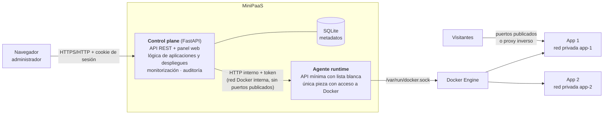
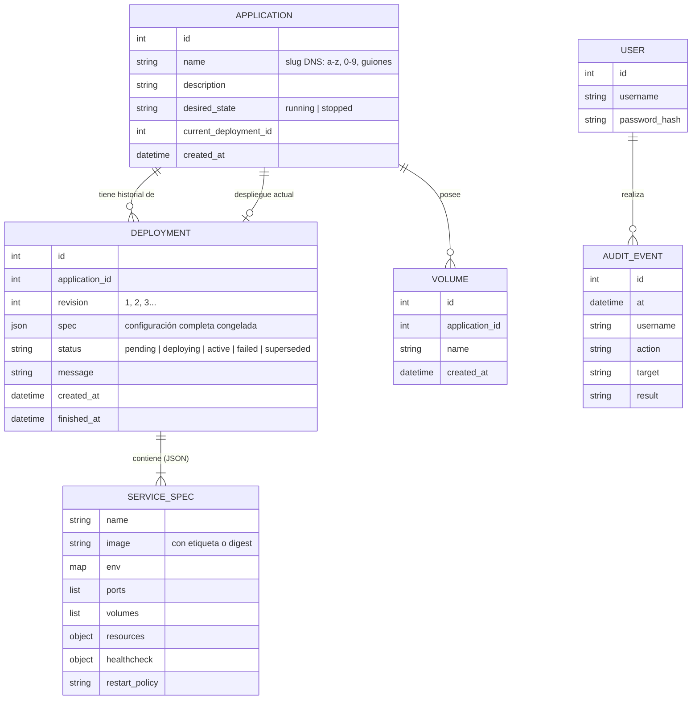
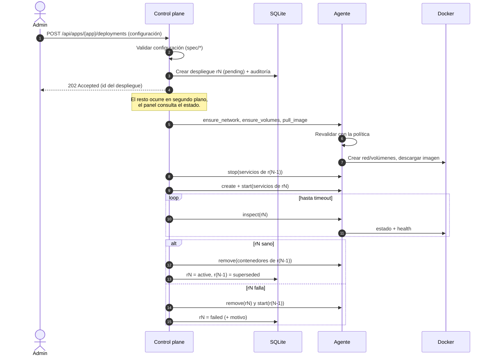

# 3. Arquitectura

> Estado del documento: **propuesta de la Fase 0**, pendiente de aprobación. Nada de lo descrito
> está implementado todavía.

## 3.1 Visión general

MiniPaaS se divide en **dos procesos** con niveles de privilegio distintos, más el runtime Docker:



| Pieza | Responsabilidad | Privilegios |
|---|---|---|
| **Panel web** | Interfaz HTML/CSS/JS servida por el control plane. Solo habla con la API REST. | Ninguno |
| **Control plane** | Autenticación, validación, modelo de aplicaciones, orquestación de despliegues, monitorización, auditoría, persistencia. | Sin acceso a Docker. Usuario no root. |
| **Agente runtime** | Traduce operaciones permitidas a llamadas de Docker. Vuelve a validar todo con una política de seguridad estricta. | Acceso al socket de Docker. Sin puertos expuestos al exterior. |
| **SQLite** | Configuración deseada, historial de despliegues, usuarios, auditoría, muestras de métricas. | Fichero en un volumen del control plane. |
| **Docker Engine** | Ejecuta los contenedores, redes y volúmenes de las aplicaciones. | — |

### ¿Por qué esta separación?

Quien controla el socket de Docker controla, en la práctica, el host como root (puede crear un
contenedor privilegiado que monte `/`). Por eso el componente expuesto a la red (control plane) **no**
tiene ese acceso. Si un atacante compromete el control plane, solo puede pedir al agente las
operaciones de su lista blanca, y el agente rechaza cualquier especificación peligrosa aunque le
llegue «desde dentro». Es el principio de **mínimo privilegio** y de **defensa en profundidad**.
Las alternativas consideradas están en `decisiones.md` (ADR-002).

## 3.2 Revisión de la arquitectura de partida

El enunciado proponía diez componentes. Se mantienen todas sus responsabilidades, pero no todas
merecen ser un componente independiente: separar en exceso crearía capas que solo se pasan datos
entre sí. Correspondencia:

| Componente propuesto | Dónde queda | Justificación |
|---|---|---|
| Frontend | Panel web (estático, servido por el control plane) | Igual. |
| API / Control Plane | Control plane: capa `api/` | Igual. |
| Application Manager | Control plane: `services/applications.py` | Igual. |
| Deployment Engine | Control plane: `services/deployments.py` | Igual; coordina el despliegue paso a paso. |
| Runtime Adapter | Se divide en **cliente del agente** (control plane) + **agente runtime** (proceso separado) | Es la frontera de privilegios: aquí sí aporta valor separar. |
| Storage Manager | Módulo `spec/storage.py` (validación y nombres de volúmenes) + operaciones de volumen del agente | No tiene estado propio; es política + traducción. |
| Network Manager | Módulo `spec/networking.py` (puertos, rango, conflictos) + operaciones de red del agente | Ídem. |
| Resource Manager | Módulo `spec/resources.py` (límites, cuotas) | Ídem. |
| Monitoring | Control plane: `services/monitoring.py` + lecturas del agente | Igual. |
| Database | SQLite + `db/` (repositorios con SQL explícito) | Igual. |

Los módulos `spec/*` tienen una única tarea: convertir la **configuración de alto nivel** que maneja
el usuario («quiero 512 MB y el puerto 8080») en una **especificación de runtime** validada que el
agente entiende. Así, almacenamiento, red y recursos quedan como piezas pequeñas, testeables y sin
capas artificiales.

## 3.3 Modelo de dominio



Decisiones de modelado:

- **La especificación de un despliegue es inmutable.** Cambiar la configuración crea una revisión
  nueva. Esto da historial y *rollback* gratis, y es la misma idea que usan Cloud Foundry
  (*droplets/releases*) y OpenShift/Kubernetes (*ReplicaSets/rollouts*).
- **Los secretos** se guardan en la especificación, pero la API nunca los devuelve en claro (se
  muestran como `••••`). El cifrado en reposo con una clave de la plataforma se evaluará en la Fase 5.
- **Estado deseado frente a estado real.** La base de datos guarda lo que *debería* estar ocurriendo
  (`desired_state`, despliegue actual). El estado real se consulta a Docker. Un sincronizador
  periódico detecta diferencias (p. ej. un contenedor caído) y las muestra; es una versión sencilla
  del *bucle de reconciliación* de Kubernetes.

## 3.4 Convenciones en Docker

Todo recurso creado por MiniPaaS sigue estas reglas, que son la base de la seguridad frente a los
servicios existentes del servidor:

| Recurso | Nombre | Etiquetas obligatorias |
|---|---|---|
| Contenedor | `minipaas-<app>-<servicio>-r<revisión>` | `minipaas.managed=true`, `minipaas.app`, `minipaas.service`, `minipaas.revision` |
| Red | `minipaas-app-<app>` | `minipaas.managed=true`, `minipaas.app` |
| Volumen | `minipaas-<app>-<volumen>` | `minipaas.managed=true`, `minipaas.app` |

El agente **rechaza** cualquier operación sobre un recurso que no tenga `minipaas.managed=true`,
aunque se le pase su identificador. Así, aunque haya un fallo en el control plane, MiniPaaS no puede
parar ni borrar un contenedor que no es suyo.

## 3.5 Flujo de un despliegue

Estrategia **recreate con restauración automática**: como los puertos publicados son fijos, no se
pueden ejecutar a la vez la versión vieja y la nueva (no es posible *blue-green* sin proxy). Se para
la versión anterior, se arranca la nueva y, si no queda sana, se restaura la anterior.



Los volúmenes nunca se borran en un redespliegue: solo al eliminar la aplicación y si el usuario lo
confirma expresamente.

Para ejecutar los despliegues en segundo plano se usará un único *worker* dentro del control plane
(una cola en memoria procesada por una tarea de `asyncio`), con un candado por aplicación para que
no haya dos despliegues simultáneos de la misma aplicación. No se necesita Celery/Redis a esta
escala. Si el control plane se reinicia a mitad de un despliegue, al arrancar marca como `failed`
los despliegues que quedaron `pending/deploying` y el sincronizador muestra el estado real.

## 3.6 API del agente (borrador)

API HTTP interna, accesible solo desde la red Docker interna de MiniPaaS, autenticada con un token
compartido generado en la instalación. Operaciones previstas (lista cerrada):

| Operación | Descripción | Comprobaciones de la política |
|---|---|---|
| `POST /networks/ensure` | Crea la red privada de una aplicación si no existe | Nombre con prefijo y etiquetas |
| `POST /volumes/ensure`, `DELETE /volumes/{name}` | Crea / borra un volumen con nombre | Prefijo `minipaas-`, etiqueta `managed` |
| `POST /images/pull` | Descarga una imagen | Formato de referencia válido; registros permitidos (configurable) |
| `POST /containers` | Crea un contenedor a partir de una `RuntimeSpec` | Ver tabla siguiente |
| `POST /containers/{id}/{start,stop,restart}`, `DELETE /containers/{id}` | Ciclo de vida | Etiqueta `managed` |
| `GET /containers?app=` | Lista contenedores de una aplicación | Filtra por etiqueta |
| `GET /containers/{id}/logs`, `/stats`, `/inspect` | Lectura de logs, consumo y estado | Etiqueta `managed`; `tail` acotado |
| `GET /host/metrics` | CPU, memoria y disco del host | Solo lectura |

La `RuntimeSpec` que acepta `POST /containers` **no tiene campos** para las opciones peligrosas: no
se puede pedir `privileged`, `cap_add`, `network_mode`, `pid`, `ipc`, `devices` ni montajes *bind*,
porque el esquema simplemente no los contempla (y rechaza campos desconocidos). Además, el agente
aplica siempre:

- `no-new-privileges`, eliminación de capacidades innecesarias cuando la imagen lo permita;
- límites de memoria y CPU obligatorios (con valores por defecto);
- solo volúmenes con nombre del propio prefijo, nunca rutas del host;
- solo puertos del host dentro del rango configurado (p. ej. 20000–20999) y en la interfaz
  configurada;
- conexión únicamente a la red privada de su aplicación.

El agente **no ofrece ninguna operación de ejecución de comandos** (`exec`) ni acceso a terminal.

## 3.7 Monitorización

| Dato | Origen | Forma de obtenerlo |
|---|---|---|
| Estado del contenedor | Docker | `inspect` bajo demanda + sincronizador periódico (≈15 s) |
| Salud | `HEALTHCHECK` de Docker definido en la spec / plantilla | Campo `State.Health` |
| CPU y memoria por servicio | API de estadísticas de Docker | Bajo demanda; muestreo opcional cada 30–60 s guardado en SQLite con retención de 24 h |
| Logs | API de logs de Docker | Últimas N líneas (N acotado), sin almacenarlos |
| Métricas del host | `psutil` en el agente (lee `/proc` del contenedor, que refleja el host para CPU/memoria) | Bajo demanda |

La métrica de disco del host requiere decidir qué ruta se monta en solo lectura para medirla; se
resolverá en la Fase 8 (posiblemente usando la información de Docker sobre el uso de disco, `system df`).

## 3.8 Despliegue de la propia plataforma

MiniPaaS se desplegará como un proyecto Docker Compose con dos contenedores:

```yaml
# Borrador ilustrativo, no definitivo
services:
  controlplane:
    user: "10001:10001"          # no root
    ports: ["127.0.0.1:8000:8000"]  # o la IP de la LAN; se decidirá en la Fase 13
    volumes: ["minipaas-data:/data"]
    networks: [minipaas-internal, default]
    # SIN socket de Docker
  agent:
    volumes: ["/var/run/docker.sock:/var/run/docker.sock"]
    networks: [minipaas-internal]   # red interna: sin salida ni puertos publicados
    read_only: true
    security_opt: ["no-new-privileges:true"]
networks:
  minipaas-internal:
    internal: true
```

> El agente necesita leer/escribir el socket de Docker. Ejecutarlo como no-root requiere que su
> usuario pertenezca al grupo propietario del socket (GID del grupo `docker` del host). Esto se
> documentará en la Fase 3. Sigue siendo el componente más sensible del sistema y así se
> reconoce en el modelo de amenazas (`04-seguridad.md`).

## 3.9 Entornos

| Entorno | Dónde | Uso |
|---|---|---|
| Desarrollo | Máquina local (Docker 29, Compose 5, Python 3.14 detectados) | Desarrollo y pruebas. Proyecto Compose `minipaas-dev`. |
| Integración | Máquina local, mismo Docker, recursos etiquetados `minipaas.test=true` y limpiados tras cada test | Tests automáticos contra Docker real |
| Producción | Servidor doméstico Ubuntu | Solo en la Fase 13 y con autorización expresa |

Las versiones del servidor real (Ubuntu, Docker, puertos ocupados, RAM/CPU) están pendientes de
recopilar y condicionan la Fase 13.
