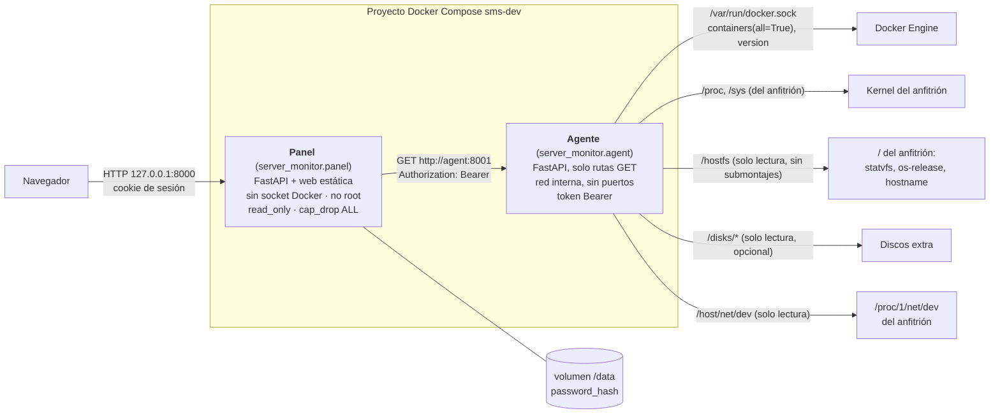
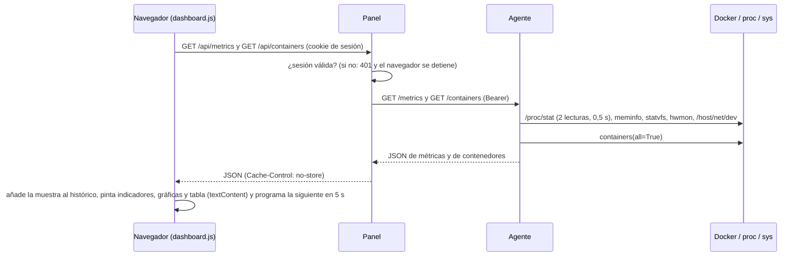

# 3. Arquitectura

> Estado del documento: **actualizado en la fase de rediseño de interfaz y limpieza (2026-11-16)**.
> Absorbe el antiguo documento de estructura del proyecto. Verificado con la prueba extremo a extremo
> y la prueba de navegador (ver [07-pruebas.md](07-pruebas.md)). La arquitectura de la etapa PaaS está
> en [historico/arquitectura-etapa-paas.md](historico/arquitectura-etapa-paas.md). El detalle del
> código está en [04-backend.md](04-backend.md) y [09-interfaz.md](09-interfaz.md).

## 3.1 Visión general

Dos procesos con privilegios distintos y ninguna base de datos:



Versión en texto:

```text
Navegador ──HTTP──▶ Panel ──HTTP interno + token──▶ Agente ──▶ Docker (socket)
   (cookie)        (sin socket,                   (único con    ──▶ /proc y /sys (anfitrión)
                    /data/password_hash)           el socket)   ──▶ /hostfs, /disks/*, /host/net/dev (solo lectura)
```

| Pieza | Responsabilidad | Privilegios |
|---|---|---|
| **Navegador** | Muestra el panel, repite la consulta cada 5 s, guarda el histórico de 10 min y calcula la velocidad de red | — |
| **Panel** (`server_monitor.panel`) | Contraseña, sesiones, CSRF, límite de intentos, cabeceras de seguridad, archivos estáticos y reenvío de `/api/metrics` y `/api/containers` al agente | Sin socket Docker. UID 10001, `read_only`, `cap_drop: ALL`, `no-new-privileges`. Solo `/data` escribible (hash) |
| **Agente** (`server_monitor.agent`) | Lee métricas del anfitrión y la lista de contenedores | Único con el socket. UID 10002, mismas restricciones. Red interna sin puertos publicados. Solo lecturas |
| **Docker Engine** | Fuente de la lista de contenedores | — |

### ¿Por qué dos procesos?

Quien tiene el socket de Docker equivale a root en el anfitrión. Si el proceso expuesto al navegador
tuviera el socket, un fallo en él daría ese acceso. Separando, el panel comprometido solo puede pedir
al agente consultas de lectura. Alternativa descartada: un solo proceso con el socket (ADR-037).

## 3.2 Flujo de una actualización



Si el agente falla, el panel responde 502 («El agente no responde»); si Docker falla, el agente
responde 503 y el panel lo reenvía como 502. El navegador muestra el estado de conexión y un aviso, y
conserva los últimos datos. Secuencias detalladas (login, métricas, contenedores, logout) en
[04-backend.md](04-backend.md), apartado 4.5.

## 3.3 Origen de cada dato

| Dato | Fuente | Por qué refleja el anfitrión |
|---|---|---|
| CPU %, núcleos, modelo | `/proc/stat` (2 lecturas), `os.cpu_count()`, `/proc/cpuinfo` | El kernel no aísla `/proc/stat` ni `/proc/cpuinfo` |
| RAM | `/proc/meminfo` | Ídem |
| Uptime | `/proc/uptime` | Ídem |
| Temperatura general | `/sys/class/hwmon` (`coretemp` «Package id 0» o `k10temp` «Tctl»); si no, `thermal_zone` `x86_pkg_temp` | Los sensores del anfitrión son visibles en `/sys` |
| Discos | `os.statvfs` de `/hostfs` (raíz) y de cada `/disks/<nombre>` | `/hostfs` es el `/` del anfitrión; `/disks/*` lo monta el administrador |
| Red | `/host/net/dev` = `/proc/1/net/dev` del anfitrión (contadores acumulados) | Se monta el archivo del anfitrión; el de `/proc/net/dev` del contenedor sería el de su propia red |
| SO | `/hostfs/etc/os-release` (o `usr/lib/os-release`) | Idem |
| Hostname | `/hostfs/etc/hostname` | Un contenedor tiene su propio *hostname* |
| Kernel, arquitectura | `os.uname()` | El kernel es compartido |
| Contenedores | `client.api.containers(all=True)` de Docker | — |
| Velocidad de red, histórico | Calculados en el navegador a partir de los contadores y `collected_at` | No se guardan en el servidor |

## 3.4 Entorno Docker (`deploy/compose.dev.yaml`)

- Proyecto `sms-dev`. Redes: `sms-internal` (`internal: true`, sin salida a Internet) y `sms-public`
  (solo para publicar el puerto del panel en `127.0.0.1`).
- Volumen `sms-data` en `/data` del panel (solo el hash de la contraseña).
- Secretos de archivo: el mismo token con una copia por componente (`panel_token`, `agent_token`;
  ADR-014).
- El agente monta el socket, el `/` del anfitrión en `/hostfs` (`read_only`, `bind.recursive:
  disabled`), `/proc/1/net/dev` en `/host/net/dev` (`:ro`) y, opcionalmente, discos extra en
  `/disks/<nombre>` (`:ro`). Añade el grupo `docker` con `group_add` para no ser root. Permisos
  completos en [04-backend.md](04-backend.md), apartado 4.8.

## 3.5 Entornos

| Entorno | Estado |
|---|---|
| Desarrollo local (CachyOS, Docker 29.9.2, Compose 5.6.1) | Usado y probado |
| Servidor Ubuntu real | **No usado ni probado**; solo con autorización expresa del usuario |

## 3.6 Datos que guarda la plataforma

Solo el hash Argon2id de la contraseña en `/data/password_hash` (permisos 600). Las sesiones y el
contador de intentos viven en memoria; el histórico de métricas, en la memoria del navegador. No se
guardan métricas ni historial en el servidor (ADR-039, ADR-047).

## 3.7 Estructura del repositorio

```text
server-monitoring-service/
├── README.md                     Presentación y puesta en marcha
├── CHANGELOG.md                  Registro de cambios
├── formato_preguntas.md          Plantilla del cuestionario de la asignatura (no se modifica)
├── pyproject.toml, uv.lock       Dependencias (extras `panel` y `agent`)
├── src/server_monitor/
│   ├── common/secrets.py         Lectura y validación del token compartido
│   ├── agent/                    Proceso con acceso a Docker (solo lectura)
│   │   ├── main.py               API: /health, /metrics, /containers (token en todas)
│   │   ├── host_metrics.py       CPU, RAM, discos, SO, uptime, temperatura, red
│   │   ├── containers.py         Lista de todos los contenedores
│   │   └── config.py             Token, SMS_HOSTFS, SMS_DISKS_DIR, SMS_NET_DEV
│   └── panel/                    Panel (sin socket Docker)
│       ├── main.py               App FastAPI, cabeceras de seguridad, estáticos
│       ├── routes.py             Rutas /api/*
│       ├── config.py             Variables de entorno
│       ├── agent_client.py       Cliente HTTP del agente
│       ├── security/             passwords (incluye APP_PASSWORD), sessions, rate_limit, csrf
│       └── web/                  Interfaz
│           ├── index.html, favicon.svg, icons.svg (+ icons-LICENSE.txt)
│           ├── css/styles.css
│           ├── fonts/            IBM Plex Sans y Mono (woff2) + OFL.txt
│           └── js/               api, app, charts, dom, format, history, session
│               └── views/        login, dashboard
├── deploy/
│   ├── Dockerfile.agent, Dockerfile.panel
│   ├── compose.dev.yaml          Entorno local de desarrollo
│   ├── requirements/             Dependencias con hashes exportadas de uv.lock (agent.txt, panel.txt)
│   └── .env.example              Ejemplo de deploy/.env
├── scripts/
│   ├── prepare_dev_env.sh        Tokens y DOCKER_GID
│   ├── verify_dev_env.sh         Comprobaciones de aislamiento del entorno (12)
│   ├── export_requirements.sh    uv.lock → deploy/requirements/*.txt
│   ├── e2e_monitor.sh            Extremo a extremo con Docker real (32 comprobaciones)
│   └── e2e_ui.py                 Recorrido en navegador con Playwright (22 comprobaciones)
├── tests/
│   ├── agent/                    Métricas, contenedores, API del agente, integración con Docker
│   ├── panel/                    API, autenticación, sesiones, limitador, configuración de APP_PASSWORD
│   └── test_secrets.py           Lectura y validación del token
├── docs/                         Esta documentación (ver docs/README.md)
└── .github/workflows/ci.yml      ruff + pytest (sin integración)
```

Ignorados por Git: `deploy/secrets/`, `deploy/.env`, `.venv/` y cachés. Detalle de cada archivo del
código en [04-backend.md](04-backend.md) y [09-interfaz.md](09-interfaz.md).

## 3.8 Qué se conserva y qué se retiró de la etapa PaaS

Se **conservan** la separación panel/agente, el token compartido, Argon2id, las sesiones, CSRF, las
cabeceras, el Compose endurecido y el CI. Se **retiraron** SQLite, aplicaciones, auditoría en base de
datos y toda operación de escritura. El diseño original (control plane con base de datos, agente con
lista blanca capaz de crear contenedores, motor de despliegue) está en el
[histórico](historico/arquitectura-etapa-paas.md).
