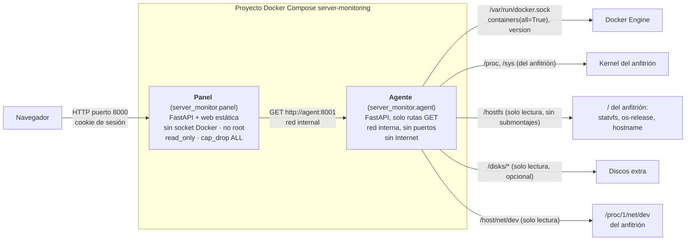
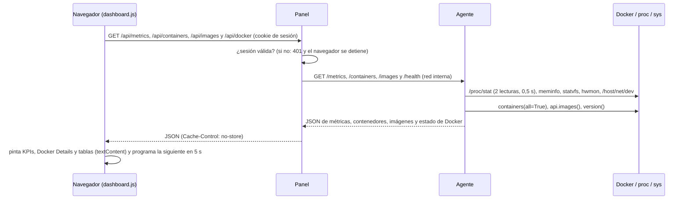

# 3. Arquitectura

> Estado del documento: **actualizado tras simplificar el despliegue (2026-11-16)**. Verificado con la
> prueba extremo a extremo y la prueba de navegador (ver [07-pruebas.md](07-pruebas.md)). Incluye la
> estructura del repositorio. La arquitectura de la etapa PaaS está en
> [historico/etapa-paas.md](historico/etapa-paas.md). El detalle del código está en
> [04-backend.md](04-backend.md) y [09-interfaz.md](09-interfaz.md).

## 3.1 Visión general

Dos procesos con privilegios distintos y ninguna base de datos:



Versión en texto:

```text
Navegador ──HTTP──▶ Panel ──HTTP por la red interna──▶ Agente ──▶ Docker (socket)
   (cookie)        (sin socket,                        (único con    ──▶ /proc y /sys (anfitrión)
                    hash en memoria)                    el socket)   ──▶ /hostfs, /disks/*, /host/net/dev (solo lectura)
```

| Pieza | Responsabilidad | Privilegios |
|---|---|---|
| **Navegador** | Muestra KPIs, Docker Details y tablas; repite la consulta cada 5 s | — |
| **Panel** (`server_monitor.panel`) | Contraseña, sesiones, CSRF, límite de intentos, cabeceras de seguridad, archivos estáticos y reenvío de `/api/metrics`, `/api/containers`, `/api/images` y `/api/docker` al agente | Sin socket Docker. UID 10001, `read_only`, `cap_drop: ALL`, `no-new-privileges`. Nada escribible salvo `/tmp` (tmpfs) |
| **Agente** (`server_monitor.agent`) | Lee métricas del anfitrión, contenedores, imágenes y estado de Docker | Único con el socket. UID 10002, mismas restricciones. Red interna sin puertos publicados ni salida a Internet. Solo lecturas |
| **Docker Engine** | Fuente de contenedores, imágenes y versión del motor | — |

### ¿Por qué dos procesos?

Quien tiene el socket de Docker equivale a root en el anfitrión. Si el proceso expuesto al navegador
tuviera el socket, un fallo en él daría ese acceso. Separando, el panel comprometido solo puede pedir
al agente consultas de lectura. Alternativa descartada: un solo proceso con el socket (ADR-037).

## 3.2 Flujo de una actualización



Si el agente falla, el panel responde 502 («El agente no responde»); si Docker falla, el agente
responde 503 y el panel lo reenvía como 502. El navegador muestra el estado de conexión y un aviso, y
conserva los últimos datos. Secuencias detalladas (login, métricas, contenedores, logout) en
[04-backend.md](04-backend.md), apartado 4.4.

## 3.3 Origen de cada dato

| Dato | Fuente | Por qué refleja el anfitrión |
|---|---|---|
| CPU %, núcleos, modelo | `/proc/stat` (2 lecturas), `os.cpu_count()`, `/proc/cpuinfo` | El kernel no aísla `/proc/stat` ni `/proc/cpuinfo` |
| RAM | `/proc/meminfo` | Ídem |
| Uptime | `/proc/uptime` | Ídem |
| Temperatura general | `/sys/class/hwmon` (`coretemp` «Package id 0» o `k10temp` «Tctl»); si no, `thermal_zone` `x86_pkg_temp` | Los sensores del anfitrión son visibles en `/sys` |
| Discos | `os.statvfs` de `/hostfs` (raíz) y de cada `/disks/<nombre>` | `/hostfs` es el `/` del anfitrión; `/disks/*` lo monta el administrador |
| Red | `/host/net/dev` = `/proc/1/net/dev` del anfitrión (contadores acumulados) | Se monta el archivo del anfitrión; el de `/proc/net/dev` del contenedor sería el de su propia red |
| SO | `/hostfs/etc/os-release` (o `usr/lib/os-release`) | Idem |
| Hostname | `/hostfs/etc/hostname` | Un contenedor tiene su propio *hostname* |
| Kernel, arquitectura | `os.uname()` | El kernel es compartido |
| Contenedores | `client.api.containers(all=True)` de Docker | — |
| Velocidad de red, histórico | Calculados en el navegador a partir de los contadores y `collected_at` | No se guardan en el servidor |

## 3.4 Entorno Docker (`docker-compose.yml`)

Un único `docker-compose.yml` en la raíz sirve para instalar en un servidor y para desarrollar.

- Proyecto `server-monitoring`. Redes: `internal` (`internal: true`, sin salida a Internet; la usan
  panel y agente) y `public` (solo el panel, para publicar el puerto 8000). Ambos servicios con
  `restart: unless-stopped`.
- **Aislamiento entre panel y agente: la red `internal`** (ADR-051). El agente no publica puertos, no
  tiene salida a Internet y solo el panel está en su red; por eso no hay token entre ellos.
- **Contraseña:** `APP_PASSWORD` en el servicio `panel`, visible y editable en el propio archivo; el
  hash Argon2id se calcula en memoria al arrancar (ADR-050).
- El agente monta el socket, el `/` del anfitrión en `/hostfs` (`read_only`, `bind.recursive:
  disabled`), `/proc/1/net/dev` en `/host/net/dev` (`:ro`) y, opcionalmente, discos extra en
  `/disks/<nombre>` (`:ro`). Corre sin root (UID 10002) y accede al socket con `group_add` y el GID
  real del servidor (`stat -c %g /var/run/docker.sock`). Permisos completos en
  [04-backend.md](04-backend.md), apartado 4.7.
- El panel no monta nada del anfitrión.

## 3.5 Entornos

| Entorno | Estado |
|---|---|
| Desarrollo local (CachyOS, Docker 29.9.2, Compose 5.6.1) | Usado y probado |
| Servidor Ubuntu real | **No usado ni probado**; solo con autorización expresa del usuario |

## 3.6 Datos que guarda la plataforma

**Nada en disco.** El hash Argon2id de la contraseña, las sesiones y el contador de intentos viven en
la memoria del panel (se pierden al reiniciarlo); el histórico de métricas, en la memoria del navegador. No se
guardan métricas ni historial en el servidor (ADR-039, ADR-047, ADR-050).

## 3.7 Estructura del repositorio

```text
server-monitoring-service/
├── README.md                     Presentación e instalación (único README del repositorio)
├── CHANGELOG.md                  Registro de cambios
├── docker-compose.yml            Panel y agente: instalación en servidor y desarrollo
├── formato_preguntas.md          Plantilla del cuestionario de la asignatura (no se modifica)
├── pyproject.toml, uv.lock       Dependencias (extras `panel` y `agent`)
├── src/server_monitor/
│   ├── agent/                    Proceso con acceso a Docker (solo lectura)
│   │   ├── main.py               API: /health, /metrics, /containers, /images
│   │   ├── host_metrics.py       CPU, RAM, discos, SO, uptime, temperatura, red
│   │   ├── containers.py         Lista de todos los contenedores
│   │   ├── images.py             Lista de imágenes y referencias
│   │   └── config.py             SMS_HOSTFS, SMS_DISKS_DIR, SMS_NET_DEV
│   └── panel/                    Panel (sin socket Docker)
│       ├── main.py               App FastAPI, cabeceras de seguridad, estáticos, lectura de APP_PASSWORD
│       ├── routes.py             Rutas /api/*
│       ├── config.py             Variables de entorno
│       ├── agent_client.py       Cliente HTTP del agente
│       ├── security/             passwords, sessions, rate_limit, csrf
│       └── web/                  Interfaz
│           ├── index.html, favicon.svg, icons.svg (+ icons-LICENSE.txt)
│           ├── css/styles.css
│           ├── fonts/            IBM Plex Sans y Mono (woff2) + OFL.txt
│           └── js/               api, app, dom, format, session
│               └── views/        login, dashboard
├── deploy/
│   ├── Dockerfile.agent, Dockerfile.panel
│   └── requirements/             Dependencias con hashes exportadas de uv.lock (agent.txt, panel.txt)
├── scripts/
│   ├── export_requirements.sh    uv.lock → deploy/requirements/*.txt
│   ├── e2e_monitor.sh            Extremo a extremo con Docker real (46 comprobaciones)
│   └── e2e_ui.py                 Recorrido en navegador con Playwright (29 comprobaciones)
├── tests/
│   ├── agent/                    Métricas, contenedores, imágenes, API del agente, integración con Docker
│   └── panel/                    API, autenticación, sesiones, limitador, arranque con APP_PASSWORD
├── docs/                         Esta documentación (ver el índice del README)
└── .github/workflows/ci.yml      ruff + pytest (sin integración)
```

Ignorados por Git: `.venv/`, `.env*` y cachés. Detalle de cada archivo del
código en [04-backend.md](04-backend.md) y [09-interfaz.md](09-interfaz.md).

## 3.8 Qué se conserva y qué se retiró de etapas anteriores

Se **conservan** la separación panel/agente, Argon2id, las sesiones, CSRF, las cabeceras, el Compose
endurecido y el CI. Se **retiraron** SQLite, aplicaciones, auditoría en base de datos y toda operación
de escritura (etapa PaaS), y después, al simplificar el despliegue, el token entre panel y agente, los
secretos de archivo, el archivo de hash con su volumen y los scripts de preparación del entorno. El
diseño original está en el [histórico](historico/etapa-paas.md).
