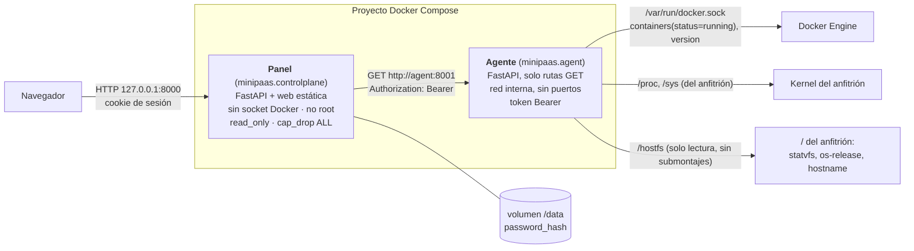

# 3. Arquitectura

> Estado del documento: **reescrito en la renovación (2026-11-16)** y verificado con la prueba
> extremo a extremo y la prueba de navegador (ver `registro-pruebas.md`). La arquitectura de la
> etapa PaaS (modelo de dominio, flujo de despliegue, API de escritura del agente, esquema SQLite)
> se resume en el apartado 3.8 y está completa en el historial de Git.

## 3.1 Visión general

Dos procesos con privilegios distintos y ninguna base de datos:



Versión en texto:

```text
Navegador ──HTTP──▶ Panel ──HTTP interno + token──▶ Agente ──▶ Docker (socket)
   (cookie)        (sin socket,                   (único con    ──▶ /proc y /sys (anfitrión)
                    /data/password_hash)           el socket)   ──▶ /hostfs (solo lectura)
```

| Pieza | Responsabilidad | Privilegios |
|---|---|---|
| **Navegador** | Muestra el panel y repite la consulta cada 5 s | — |
| **Panel** (`minipaas.controlplane`) | Contraseña, sesiones, CSRF, límite de intentos, cabeceras de seguridad, archivos estáticos y reenvío de `/api/metrics` y `/api/containers` al agente | Sin socket Docker. UID 10001, `read_only`, `cap_drop: ALL`, `no-new-privileges`. Solo `/data` escribible (hash) |
| **Agente** (`minipaas.agent`) | Lee métricas del anfitrión y la lista de contenedores en ejecución | Único con el socket. UID 10002, mismas restricciones. Red interna sin puertos publicados. `/` del anfitrión en solo lectura |
| **Docker Engine** | Fuente de la lista de contenedores | — |

### ¿Por qué dos procesos?

Quien tiene el socket de Docker equivale a root en el anfitrión. Si el proceso expuesto al navegador
tuviera el socket, un fallo en él daría ese acceso. Separando, el panel comprometido solo puede
pedir al agente tres consultas de lectura. Alternativa descartada: un solo proceso con el socket
(ADR-037).

## 3.2 Componentes y módulos

### Panel (`src/minipaas/controlplane/`)

| Archivo | Qué hace |
|---|---|
| `main.py` | Crea la app FastAPI, añade cabeceras de seguridad y la comprobación de `Origin`, monta los estáticos |
| `routes.py` | Rutas `/api/*`: salud, sesión, login, logout, métricas, contenedores |
| `config.py` | Configuración desde variables de entorno |
| `agent_client.py` | Cliente HTTP (httpx) del agente; convierte cualquier fallo en `AgentError` |
| `manage.py` | CLI `set-password` |
| `security/passwords.py` | Validación de longitud, hash Argon2id, lectura del archivo de hash |
| `security/sessions.py` | Sesiones en memoria; el identificador se guarda como SHA-256; caducidad |
| `security/rate_limit.py` | Límite de fallos de login por IP |
| `security/csrf.py` | Comprobación de `Origin` y del token CSRF |
| `web/` | Panel: `index.html`, CSS y JavaScript sin framework (`js/views/login.js`, `js/views/dashboard.js`) |

### Agente (`src/minipaas/agent/`)

| Archivo | Qué hace |
|---|---|
| `main.py` | App FastAPI con token en todas las rutas; `/health`, `/metrics`, `/containers` |
| `host_metrics.py` | Lee `/proc`, `/sys`, `os-release`, `hostname` y `statvfs` |
| `containers.py` | Una consulta de solo lectura a Docker y conversión a JSON |
| `config.py` | Token y `MINIPAAS_HOSTFS` |

`src/minipaas/common/secrets.py` (lectura y validación del token) es compartido por ambos.

## 3.3 Flujo de una actualización

```mermaid
sequenceDiagram
    participant B as Navegador (dashboard.js)
    participant P as Panel
    participant A as Agente
    participant D as Docker / proc / sys

    B->>P: GET /api/metrics (cookie de sesión)
    P->>P: ¿sesión válida? (si no: 401 y el navegador se detiene)
    P->>A: GET /metrics (Bearer)
    A->>D: lee /proc/stat, espera 0,5 s, vuelve a leer; /proc/meminfo; statvfs; /sys
    A-->>P: JSON de métricas
    P-->>B: JSON (Cache-Control: no-store)
    B->>P: GET /api/containers
    P->>A: GET /containers (Bearer)
    A->>D: containers(status=running)
    A-->>P: JSON de contenedores
    P-->>B: JSON
    B->>B: pinta tarjetas y tabla (textContent) y programa la siguiente en 5 s
```

Si el agente falla el panel responde 502 («El agente no responde»); si Docker falla, el agente
responde 503 («Docker no está disponible») y el panel lo reenvía como 502; el navegador muestra
«No se pudo actualizar; se muestran los últimos datos».

## 3.4 Origen de cada dato

| Dato | Fuente | Por qué refleja el anfitrión |
|---|---|---|
| CPU % | Dos lecturas de `/proc/stat` | `/proc/stat` de un contenedor muestra el del anfitrión |
| Núcleos, modelo | `os.cpu_count()`, `/proc/cpuinfo` | Ídem |
| RAM | `/proc/meminfo` | Ídem |
| Uptime | `/proc/uptime` | Ídem |
| Temperaturas | `/sys/class/thermal/thermal_zone*` | `/sys` del contenedor muestra los sensores del anfitrión |
| Disco | `os.statvfs("/hostfs")` | `/hostfs` es el `/` del anfitrión |
| SO | `/hostfs/etc/os-release` (o `usr/lib/os-release`) | Idem |
| Hostname | `/hostfs/etc/hostname` | Un contenedor tiene su propio *hostname* |
| Kernel, arquitectura | `os.uname()` | El kernel es compartido |
| Contenedores | `containers(status=running)` de Docker | — |

## 3.5 Entorno Docker (`deploy/compose.dev.yaml`)

- Proyecto `minipaas-dev`. Redes: `minipaas-internal` (`internal: true`, sin salida a Internet) y
  `minipaas-public` (solo para publicar el puerto del panel en `127.0.0.1`).
- Volumen `minipaas-data` en `/data` del panel (solo el hash de la contraseña).
- Secretos de archivo: el mismo token con una copia por componente (ADR-014).
- El agente monta el socket y `/` en `/hostfs` (`read_only: true`, `bind.recursive: disabled`) y
  añade el grupo `docker` con `group_add` para no ser root.

## 3.6 Entornos

| Entorno | Estado |
|---|---|
| Desarrollo local (CachyOS, Docker 29.9.2) | Usado y probado |
| Servidor Ubuntu real | **No usado ni probado**; solo con autorización expresa del usuario |

## 3.7 Datos que guarda la plataforma

Solo el hash Argon2id de la contraseña en `/data/password_hash` (permisos 600). Las sesiones y el
contador de intentos viven en memoria. No se guardan métricas ni historial (ADR-039).

## 3.8 Historia: arquitectura de la etapa PaaS (Fases 0 a 3)

La arquitectura aprobada en la Fase 0 era un *control plane* con SQLite (aplicaciones, despliegues,
usuarios, auditoría), un agente con lista blanca capaz de crear y borrar contenedores, redes y
volúmenes (`ServiceRequest`, etiqueta `minipaas.managed`), un motor de despliegue con revisiones y
*rollback*, y plantillas. La Fase 2 implementó la persistencia, las aplicaciones sin Docker y la
autenticación. La Fase 3 (rama `fase-03-motor-despliegue`, no aprobada) implementó el motor de
despliegue. La renovación **conserva** de esa etapa la separación panel/agente, el token compartido,
Argon2id, sesiones, CSRF, cabeceras, Compose endurecido y CI; y **retira** SQLite, aplicaciones,
auditoría en BD, `naming.py` y toda operación de escritura. Las ADR afectadas están marcadas como
sustituidas en `decisiones.md`.
