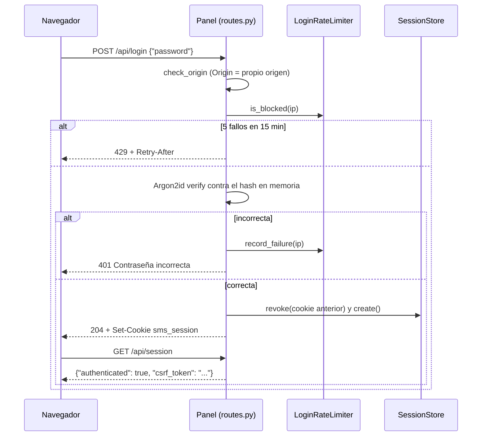
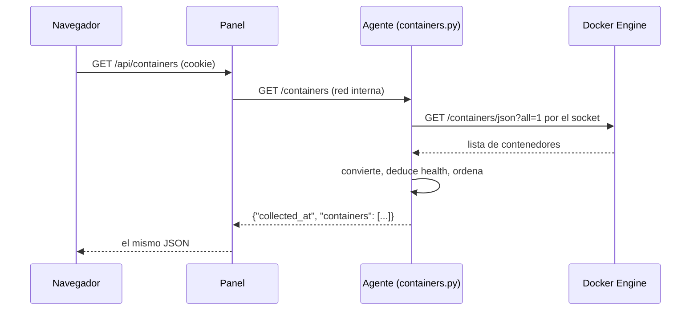
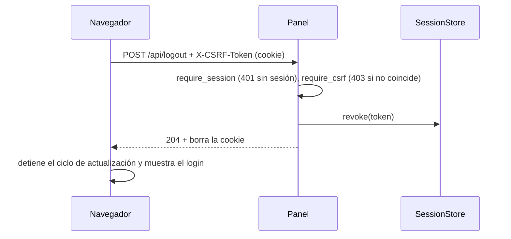

# 4. Backend

> Estado del documento: **actualizado tras simplificar el despliegue (2026-11-16)**.
> Describe el código real de `src/server_monitor/` (agente y panel). Cada afirmación
> está contrastada con el código; las pruebas que la respaldan están en [07-pruebas.md](07-pruebas.md).
> Para la vista general, ver [03-arquitectura.md](03-arquitectura.md); para los formatos JSON,
> [05-api.md](05-api.md); para el frontend, [09-interfaz.md](09-interfaz.md).

El backend son **dos procesos FastAPI** con privilegios distintos y ningún almacén de datos (nada se
guarda en disco):

- el **agente** (`server_monitor.agent`, puerto 8001, solo red interna) lee el anfitrión y Docker;
- el **panel** (`server_monitor.panel`, puerto 8000) autentica al administrador, reenvía los datos del
  agente y sirve la interfaz web.

## 4.1 Agente (`src/server_monitor/agent/`)

| Archivo | Líneas | Responsabilidad |
|---|---|---|
| `main.py` | 42 | App FastAPI solo con rutas GET y sin autenticación: `/health`, `/metrics`, `/containers` |
| `host_metrics.py` | 217 | Lectura de `/proc`, `/sys`, `os-release`, `hostname`, `statvfs` y `/proc/net/dev` |
| `containers.py` | 60 | Consulta de contenedores a Docker y conversión a JSON |
| `config.py` | 17 | `AgentSettings`: `SMS_HOSTFS`, `SMS_DISKS_DIR`, `SMS_NET_DEV` |

### `main.py`

- `create_app(settings, client)` recibe la configuración y el cliente de Docker (así los tests inyectan
  un cliente falso).
- **No hay autenticación** (ADR-051): el agente solo es alcanzable desde la red `internal` de Compose,
  que comparte únicamente con el panel, no publica puertos y no tiene salida a Internet.
- Sin `/docs`, `/redoc` ni `/openapi.json` (`docs_url=None, redoc_url=None, openapi_url=None`).
- Las rutas son `def` (no `async def`): FastAPI las ejecuta en un hilo, de modo que los 0,5 s de espera
  de la medición de CPU no bloquean a otras peticiones.
- `build_app_from_env()` es la factoría de uvicorn: crea el cliente con `docker.from_env(version="1.44")`.
  Con la versión de la API fijada el cliente no consulta al demonio al crearse, así que el agente
  arranca aunque Docker no esté disponible (`/health` lo mostrará) y se recupera solo.
- `/containers` captura cualquier excepción de Docker y responde 503 `Docker no está disponible` sin
  detalles internos.

### `host_metrics.py`: de dónde sale cada métrica

Todas las funciones reciben la ruta como parámetro (con valores por defecto reales) para poder
probarlas con directorios falsos.

| Dato | Fichero de origen | Cálculo |
|---|---|---|
| CPU % | `/proc/stat` (línea `cpu`) | Se lee, se espera 0,5 s (`time.sleep`) y se vuelve a leer. `idle = idle + iowait` (campos 4.º y 5.º); `uso = 100 × (1 − Δidle / Δtotal)`, 1 decimal. Si `Δtotal ≤ 0`, 0 % |
| Núcleos | `os.cpu_count()` | Núcleos lógicos que ve el proceso (los del anfitrión, porque no se limitan) |
| Modelo de CPU | `/proc/cpuinfo`, primera línea `model name` | `null` si no existe (p. ej. en ARM) |
| RAM | `/proc/meminfo` (`MemTotal`, `MemAvailable`, en kB × 1024) | `usada = MemTotal − MemAvailable`; `porcentaje = usada / total × 100` |
| Uptime | `/proc/uptime` (primer campo) | Segundos enteros; `null` si falla |
| Hostname | `<hostfs>/etc/hostname` | Texto recortado; `null` si falla |
| Sistema operativo | `<hostfs>/etc/os-release`, o `usr/lib/os-release` | Valor de `PRETTY_NAME`; `null` si no está |
| Kernel y arquitectura | `os.uname()` (`release`, `machine`) | El kernel es el mismo en el contenedor y en el anfitrión |
| Disco | `os.statvfs(ruta)` | `total = f_blocks·f_frsize`; `libre = f_bavail·f_frsize`; `usado = (f_blocks − f_bfree)·f_frsize`; `porcentaje = usado / (usado + libre) × 100` (como `df`) |
| Temperatura | `/sys/class/hwmon`, o `/sys/class/thermal` | Ver más abajo |
| Red | `SMS_NET_DEV` (`/host/net/dev` en Compose) | Ver más abajo |
| `collected_at` | Reloj del sistema | UTC con milisegundos (`now_iso()`) |

**Por qué son datos del anfitrión y no del contenedor.** Docker aísla con *namespaces* algunos
recursos (procesos, red, montajes, hostname), pero **no** `/proc/stat`, `/proc/meminfo`, `/proc/uptime`
ni `/proc/cpuinfo`: el kernel los comparte y un contenedor sin límites ve los valores del anfitrión (el
E2E lo comprueba: RAM total igual a `MemTotal` del anfitrión, uptime ±60 s). El kernel (`os.uname`) también es el mismo. En cambio **sí**
son propios del contenedor el sistema de archivos (por eso `statvfs("/")` mediría el contenedor), el
*hostname* y la red; para esos se monta lo necesario en solo lectura (apartado 4.7). `/sys/class/hwmon`
no está aislado: refleja los sensores del anfitrión.

**Discos (`read_disks`).** Primero el raíz, medido en `SMS_HOSTFS` (el `/` del anfitrión montado en
`/hostfs`), con nombre «Sistema» y ruta `/`. Después cada subdirectorio de `SMS_DISKS_DIR` (por defecto
`/disks`), ordenado por nombre, con ruta `/disks/<nombre>`. Se omite el que tenga el mismo `st_dev`
que el raíz (sería el mismo disco), y el que dé error de lectura. Si `/disks` no existe, solo se
devuelve el raíz.

**Temperatura (`read_temperature`).** Una sola cifra: el paquete del procesador.
1. Para cada `/sys/class/hwmon/hwmon*` se lee `name`. Si es `coretemp` se busca el `temp*_label` igual a
   `Package id 0` y se lee su `temp*_input`; si es `k10temp`, el de etiqueta `Tctl` (o `temp1_input` si
   no hay etiquetas). El valor está en milésimas de grado.
2. Si no hay ninguno, la `thermal_zone*` de `/sys/class/thermal` cuyo `type` es `x86_pkg_temp`.
3. Se descarta cualquier valor ≤ 0 o > 150 °C. Si no hay ninguno, el resultado es `null`.
Se devuelve `{"celsius": 46.0, "sensor": "coretemp: Package id 0"}`. Nunca se promedia ni se inventa
(ADR-045).

**Red (`read_network`).** `/proc/net/dev` tiene dos líneas de cabecera y una línea por interfaz:
`nombre: rx_bytes ... tx_bytes ...`. Tras el `:` el campo 0 son los bytes recibidos y el campo 8 los
enviados. Se excluyen las interfaces cuyo nombre empieza por `lo`, `veth`, `br-`, `docker` o
`virbr`. El resultado es la suma y la lista por interfaz. Son contadores **acumulados desde el
arranque**: la velocidad no se calcula aquí, la calcula el navegador (apartado 4.9). Si el archivo no
se puede leer, el campo `network` es `null`.

**Por qué la red es del anfitrión.** `/proc/net/dev` dentro del contenedor muestra *su* red. Compose
monta el archivo `/proc/1/net/dev` **del anfitrión** (el proceso 1 vive en el espacio de nombres de red
del anfitrión) en `/host/net/dev`, como un único archivo de solo lectura, y `SMS_NET_DEV` apunta a él
(ADR-046). Así no hace falta `network_mode: host`.

### `containers.py`: consulta de contenedores

`list_containers(client)` hace **una sola llamada de lectura**: `client.api.containers(all=True)`, que
es `GET /containers/json?all=1` de la API de Docker (todos los contenedores, también los detenidos).
De cada elemento se toman estos campos y se convierten:

| Campo devuelto | Origen en la respuesta de Docker |
|---|---|
| `id` | `Id`, primeros 12 caracteres |
| `name` | `Names[0]` sin la barra inicial (si no hay nombre, el id corto) |
| `image` | `Image` |
| `state` | `State` (`running`, `exited`, `paused`, `restarting`, `created`, `dead`, `removing`) |
| `status` | `Status` (texto de Docker, p. ej. `Up 3 hours (healthy)`, en inglés) |
| `health` | Deducido de `Status` (ver abajo) |
| `created_at` | `Created` (segundos desde 1970) → UTC `YYYY-MM-DDTHH:MM:SSZ` |
| `ports` | `Ports`: `PrivatePort` → `container_port`, `Type` → `protocol`, `IP` → `host_ip`, `PublicPort` → `host_port` (`null` si no está publicado) |
| `compose_project`, `compose_service` | Etiquetas `com.docker.compose.project` y `com.docker.compose.service` (o `null`) |

**Salud (`_health_from_status`).** Docker escribe el resultado del *healthcheck* en el texto de
`Status`. Se busca, por este orden, `(unhealthy)`, `(healthy)` y `(health: starting)`; si no aparece
ninguno (contenedor sin *healthcheck* o detenido), `health` es `null`.

**Orden.** `sorted(..., key=(state != "running", name))`: primero los que están en ejecución, y dentro de
cada grupo por nombre. Un mismo puerto publicado en IPv4 e IPv6 llega repetido (`0.0.0.0` y `::`); el
agente lo devuelve tal cual y es la interfaz la que lo agrupa.

`docker_status(client)` (para `/health`) llama a `client.version()` y devuelve `reachable` y
`server_version`; ante cualquier excepción, `reachable: false`.

**Solo lectura.** Las dos únicas llamadas a Docker del código son `containers(all=True)` y
`version()`. Los tests usan un cliente falso que falla ante cualquier otra operación, y el E2E comprueba
que `docker events` no registra eventos de modificación durante las consultas.

## 4.2 Panel (`src/server_monitor/panel/`)

| Archivo | Líneas | Responsabilidad |
|---|---|---|
| `main.py` | 99 | `create_app`: cabeceras de seguridad, `Origin`, enrutado, estáticos; `build_app_from_env` (valida `APP_PASSWORD` y calcula su hash antes de crear la app) |
| `routes.py` | 118 | Rutas `/api/*`: `health`, `session`, `login`, `logout`, `metrics`, `containers` |
| `config.py` | 44 | `PanelSettings` desde variables de entorno, con validación |
| `agent_client.py` | 38 | `AgentClient` (httpx) hacia el agente; `AgentError` |
| `security/passwords.py` | 23 | Política de longitud (4 a 128), hash y verificación Argon2id |
| `security/sessions.py` | 64 | `SessionStore`: sesiones en memoria |
| `security/rate_limit.py` | 41 | `LoginRateLimiter`: fallos por IP en ventana deslizante |
| `security/csrf.py` | 21 | Comprobación de `Origin` y del token CSRF |
| `web/` | — | Interfaz (ver [09-interfaz.md](09-interfaz.md)) |

### `main.py`

- `create_app(settings, agent_client, password_hash, sessions=None, limiter=None)` guarda los objetos en
  `app.state` y registra `check_origin` como dependencia global.
- Un *middleware* añade a **todas** las respuestas `Content-Security-Policy: default-src 'self'`,
  `X-Content-Type-Options: nosniff`, `Referrer-Policy: no-referrer` y `X-Frame-Options: DENY`; y
  `Cache-Control: no-store` a las de `/api/`.
- El *router* de `/api` se registra antes de montar `StaticFiles(directory=web, html=True)` en `/`; si
  fuera al revés, los estáticos taparían la API.
- `lifespan` cierra el cliente HTTP del agente al apagar. Sin `/docs` ni `/redoc` (cargan un CDN).
- `build_app_from_env()` sigue esta **secuencia de arranque**: (1) configura el registro de logs (nivel
  INFO); (2) lee `APP_PASSWORD` y comprueba que tiene entre 4 y 128 caracteres; si no, registra el
  motivo (sin el valor) y termina con `raise SystemExit(1)`, así `uvicorn` sale sin traceback y el
  contenedor se detiene con código 1 (con `restart: unless-stopped` Docker lo reintenta y repite el
  error); (3) lee `PanelSettings`; (4) calcula el hash Argon2id **en memoria** y crea el `AgentClient`;
  (5) `create_app`.

### `agent_client.py`

Un `httpx.AsyncClient` con `base_url = SMS_AGENT_URL` y tiempo máximo de 3 s. `_get(path)` hace el `GET`, exige estado 2xx y devuelve el JSON **tal cual**; cualquier
fallo (red, tiempo, estado de error, JSON inválido) se convierte en `AgentError` y solo se registra el
tipo de excepción (el detalle no llega al navegador). El panel **no transforma** los datos: reenvía lo
que dice el agente.

### `config.py`

`PanelSettings` es un `dataclass` inmutable. Se leen del entorno `SMS_AGENT_URL` y
`SMS_COOKIE_SECURE` (`true`/`false`; otro valor
lanza `ConfigError`). El resto son constantes del código: tiempo máximo hacia el agente 3 s, sesión
30 min de inactividad y 8 h absolutas, 5 fallos de login en 15 min.

## 4.3 Autenticación

| Aspecto | Cómo funciona (código) |
|---|---|
| Contraseña | Única, de 4 a 128 caracteres (`passwords.py`), sin usuario. No se recorta (los espacios cuentan) |
| Hash | Argon2id con los parámetros por defecto de `argon2-cffi` (3 iteraciones, 64 MiB). Se calcula al arrancar a partir de `APP_PASSWORD` y vive **solo en la memoria** del panel; no se escribe en disco |
| Verificación | `verify_password` devuelve `False` ante contraseña incorrecta o hash inválido |
| Sesión | `SessionStore`: diccionario en memoria. El identificador (`secrets.token_urlsafe(32)`, 256 bits) viaja solo en la cookie; el servidor guarda su **SHA-256** como clave. Cada sesión lleva su token CSRF aleatorio |
| Caducidad | Inactividad > 30 min o antigüedad ≥ 8 h. Cada consulta válida renueva la inactividad. Las caducadas se purgan al crear una sesión nueva |
| Cookie | `sms_session`; `HttpOnly`; `SameSite=Strict`; `Path=/`; `Max-Age` = 8 h; `Secure` solo si `SMS_COOKIE_SECURE=true` |
| Límite de intentos | `LoginRateLimiter`: ventana deslizante en memoria con los instantes de los fallos de cada IP. Con 5 fallos en 15 min se responde 429 + `Retry-After`, **incluso con la contraseña correcta**. Un acceso correcto no reinicia el contador |
| CSRF | Token por sesión que el navegador obtiene con `GET /api/session` y envía en `X-CSRF-Token`; se exige en `POST /api/logout` (403 si falta o no coincide; comparación en tiempo constante) |
| `Origin` | Dependencia global: las peticiones `POST`, `PUT`, `PATCH`, `DELETE` con cabecera `Origin` distinta del propio origen reciben 403. Sin `Origin` (curl, scripts) se aceptan |
| Registro | Logger `server_monitor.access`: login correcto/fallido/bloqueado y logout. Nunca la contraseña |
| Cambio de contraseña | Se edita `APP_PASSWORD` en `docker-compose.yml` y se ejecuta `docker compose up -d`, que recrea el panel. Esto cierra todas las sesiones, porque están en memoria |

### Contraseña: `APP_PASSWORD`

La contraseña se escribe en el servicio `panel` de `docker-compose.yml` (ADR-050). Al arrancar,
`build_app_from_env()` la valida y calcula su hash Argon2id en memoria:

| Situación | Resultado | Log |
|---|---|---|
| `APP_PASSWORD` válida (4 a 128 caracteres) | Arranque normal | Sin el valor |
| Ausente, vacía o fuera de 4 a 128 caracteres | No arranca: código de salida 1, sin traceback | ERROR «APP_PASSWORD falta, está vacía o no tiene entre 4 y 128 caracteres: escríbela en el servicio panel de docker-compose.yml y ejecuta docker compose up -d» |

No hay archivo de hash, volumen ni comando para cambiarla: se edita el archivo y se recrea el panel con
`docker compose up -d`. Como las sesiones están en memoria, eso cierra todas las sesiones abiertas.

`require_session` (dependencia de `metrics`, `containers` y, vía `require_csrf`, de `logout`) busca la
cookie, calcula el SHA-256 y consulta el almacén; sin sesión válida, 401.

## 4.4 Secuencias de las operaciones

### Login



### Consulta de métricas (una actualización)

```mermaid
sequenceDiagram
    participant B as Navegador (dashboard.js)
    participant P as Panel
    participant A as Agente (host_metrics.py)
    participant K as /proc, /sys, /hostfs, /disks, /host/net/dev

    B->>P: GET /api/metrics (cookie)
    P->>P: require_session (SHA-256 de la cookie en SessionStore)
    P->>A: GET /metrics (red interna)
    A->>K: /proc/stat, espera 0,5 s, /proc/stat; meminfo; uptime; cpuinfo
    A->>K: statvfs(/hostfs), statvfs(/disks/*); hwmon; /host/net/dev; os-release; hostname
    A-->>P: JSON de métricas
    P-->>B: el mismo JSON (Cache-Control: no-store)
```

### Consulta de contenedores



El navegador lanza las dos consultas a la vez (`Promise.all`). Errores: si el agente no responde o falla,
el panel contesta 502 `El agente no responde`; si es Docker quien falla, el agente contesta 503 y el
panel lo reenvía como 502.

### Logout



## 4.5 Actualización de datos

Es el navegador quien consulta; el servidor no empuja nada (ADR-041).

- `dashboard.js` ejecuta `refresh()` y, al terminar (con éxito o error), programa la siguiente con
  `setTimeout` a 5 000 ms. El encadenado evita que las consultas se solapen.
- Con la pestaña oculta (`document.hidden`) no se programa ninguna; al volver (`visibilitychange`) se
  actualiza al instante y se reanuda el ciclo.
- Al cerrar sesión o al recibir 401 se llama a la función de parada devuelta por `render`.
- Si falla cualquiera de las dos consultas, **no se actualiza nada** (los datos mostrados son siempre
  coherentes entre sí) y aparece el aviso con el motivo (agente sin respuesta, sin conexión...).
- El histórico para las gráficas vive solo en la memoria de la pestaña: `history.js` guarda como máximo
  120 muestras (10 minutos) y descarta las más antiguas. Al recargar empieza de cero. El servidor no
  guarda métricas.

## 4.6 Cómo se comunican el panel y el agente

HTTP por la red `internal` de Compose, sin autenticación (ADR-051). El agente no tiene puertos
publicados ni salida a Internet; solo el panel está en esa red y puede alcanzarlo. Quien llegue a la
red `internal` (otro contenedor que se añadiera a ella) podría consultar al agente: por eso solo debe
usarla el panel.

## 4.7 Permisos de cada contenedor

Según `docker-compose.yml` y los Dockerfiles:

| Aspecto | Panel | Agente |
|---|---|---|
| Usuario | `sms-panel`, UID 10001 (no root) | `sms-agent`, UID 10002 (no root) |
| Redes | `internal` y `public` | Solo `internal` (`internal: true`, sin salida a Internet) |
| Puertos publicados | `8000:8000` (editable, p. ej. `127.0.0.1:8000:8000`) | Ninguno |
| Socket Docker | **No** | `/var/run/docker.sock` (sin `:ro`: `:ro` no limita la API, ADR-037). Acceso al socket sin ser root con `group_add: ["999"]`, cambiando 999 por el GID real (`stat -c %g /var/run/docker.sock`) |
| Sistema de archivos del anfitrión | No | `/` → `/hostfs`, `read_only`, `bind.recursive: disabled` (sin submontajes, ADR-038) |
| Red del anfitrión | No | `/proc/1/net/dev` → `/host/net/dev`, `:ro` (un único archivo, ADR-046) |
| Discos extra | No | Cada uno `:ro` en `/disks/<nombre>`; comentado por defecto (ADR-044) |
| Escritura | Solo `tmpfs` en `/tmp` | Solo `tmpfs` en `/tmp` |
| Sistema de archivos raíz | `read_only: true` | `read_only: true` |
| Capabilities | `cap_drop: [ALL]` | `cap_drop: [ALL]` |
| Escalada de privilegios | `no-new-privileges:true` | `no-new-privileges:true` |
| Comprobación de salud | `GET /api/health` cada 10 s (Python `urllib`) | `GET /health` cada 10 s (Python `urllib`) |
| Reinicio | `restart: unless-stopped` | `restart: unless-stopped` |

El Dockerfile de cada componente instala las dependencias con `pip --require-hashes` desde
`deploy/requirements/{panel,agent}.txt` (el agente lleva el SDK de Docker; el panel, `httpx` y
`argon2-cffi`) y arranca con `uvicorn --factory`.

## 4.8 Configuración: variables de entorno

| Variable | Componente | Defecto en el código | Valor en `docker-compose.yml` | Uso |
|---|---|---|---|---|
| `APP_PASSWORD` | Panel | (obligatoria) | `""`: hay que escribirla | Contraseña del panel (4–128 caracteres). Solo se conserva su hash, en memoria |
| `SMS_AGENT_URL` | Panel | `http://agent:8001` | (por defecto) | Dirección del agente |
| `SMS_COOKIE_SECURE` | Panel | `false` | (por defecto) | `true` si hay HTTPS |
| `SMS_HOSTFS` | Agente | `/` | `/hostfs` | Raíz del anfitrión (disco «Sistema», os-release, hostname) |
| `SMS_DISKS_DIR` | Agente | `/disks` | `/disks` | Directorio con los discos extra |
| `SMS_NET_DEV` | Agente | `/proc/net/dev` | `/host/net/dev` | Contadores de red del anfitrión |

El GID del socket no es una variable: se escribe directamente en `group_add` del servicio `agent`.

Para las pruebas: `SMS_URL`, `APP_PASSWORD` y `SMS_SCREENSHOTS` (`scripts/e2e_ui.py`) y `CHROMIUM_PATH`.

## 4.9 Qué hace el navegador con los datos

El backend entrega **contadores y estado**; el navegador calcula lo demás. Por ejemplo, la velocidad de red es
`(bytes_ahora − bytes_antes) / (collected_at_ahora − collected_at_antes)` entre dos muestras seguidas.
Si un contador baja (reinicio del servidor), no se calcula y la gráfica deja un hueco. Detalle en
[09-interfaz.md](09-interfaz.md).

## 4.10 Errores y límites conocidos del backend

- `GET /metrics` no captura errores de lectura de `/proc` salvo los previstos (`null`): un fallo
  inesperado devolvería 500 y el panel lo mostraría como 502.
- Cada llamada a `/metrics` dura unos 0,5 s por la medición de CPU.
- El texto de `status` de los contenedores es el de Docker, en inglés.
- La red suma todas las interfaces no virtuales, incluidas VPN como `tailscale0`.
- Sesiones y limitador en memoria: se pierden al reiniciar el panel y solo valen con un proceso.
- El socket de Docker da al agente un acceso equivalente a root; la solo-lectura la garantiza el código.
