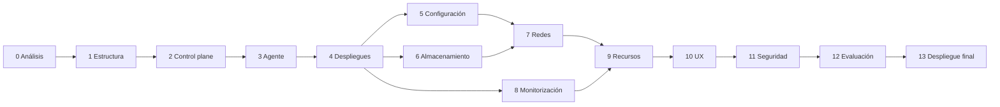

# 6. Roadmap

> Estado del documento: **aprobado por el equipo (2026-11-15)**.

## 6.1 Cambios respecto a la planificación inicial

| Cambio | Motivo |
|---|---|
| **El panel web se construye de forma incremental** desde la Fase 2, en lugar de concentrarlo en la Fase 10. La Fase 10 pasa a ser de *experiencia de usuario y pulido*. | Si la interfaz se deja para el final, cada funcionalidad se valida solo por API y se descubren problemas de usabilidad tarde. Además, se puede enseñar progreso real en cada revisión. |
| **La autenticación entra en la Fase 2** y **el agente privilegiado en la Fase 3**. La Fase 11 pasa a ser de *endurecimiento y auditoría*. | La seguridad es un requisito de diseño: no se puede añadir al final sin rehacer la API ni la integración con Docker. |
| **El agente runtime se introduce en la Fase 3** junto con el modelo de aplicaciones. | Es la única vía de acceso a Docker; todas las fases siguientes dependen de él. |
| **Las aplicaciones multi-servicio se implementan en la Fase 7** (redes), con un solo servicio hasta entonces. | Primero se consolida el ciclo completo con un servicio; la red privada por aplicación es la que habilita varios servicios. |
| **El cuestionario GIFT** (10 preguntas, ver `formato_preguntas.md`) se incluye en la Fase 13. | Es un entregable de la asignatura detectado en el repositorio. |

Estos cambios fueron **aprobados por el equipo el 2026-11-15**.

## 6.2 Fases

Estado a 2026-11-15: Fases 0, 1 y 2 **aprobadas**; Fase 3 **terminada, pendiente de aprobación**; el
resto, pendientes.

**Reajuste tras la Fase 3.** Por indicación del enunciado de la Fase 3, se adelantaron partes de las
Fases 4 y 7: revisiones inmutables, despliegue en segundo plano, rollback automático, catálogo de
imágenes, varios servicios por aplicación y redes por aplicación. Lo que queda de esas fases se indica
en sus filas.

| Fase | Nombre | Objetivo y entregables principales | Criterio de aceptación |
|---|---|---|---|
| 0 | Análisis y arquitectura | Requisitos, arquitectura, decisiones, riesgos, estrategia de pruebas, documentación inicial. | Documentación revisada y aprobada. |
| 1 | Estructura y entorno aislado | Estructura de directorios, `pyproject.toml`, `ruff`, `pytest`, Dockerfiles, `compose.dev.yaml` con control plane y agente «hola mundo», CI básica, guía de desarrollo. | `docker compose up` local arranca ambos procesos; el control plane llama al agente; CI en verde; el control plane no ve el socket. |
| 2 | Control plane, base de datos y API básica | SQLite + esquema y migraciones, modelo de aplicaciones (sin Docker), autenticación, CSRF, auditoría, esqueleto del panel (login + lista de aplicaciones). | CRUD de aplicaciones por API y panel con sesión; tests de API en verde. **Cumplido** (pendiente de aprobación): 214 tests, E2E 12/12, recorrido del panel en navegador. |
| 3 | Motor de despliegue y servicios Docker | Agente con operaciones cerradas; catálogo por digest; servicios; revisiones inmutables; despliegue `recreate` con rollback; redes por aplicación; detener/arrancar/recuperar; operaciones interrumpidas; panel. | **Cumplido** (pendiente de aprobación): E2E con Docker real 23/23, 437 tests, aislamiento 12/12. |
| 4 | Plantillas y rollback manual | (Revisiones, despliegue en segundo plano y rollback automático: **hechos en la Fase 3**.) Pendiente: volver a desplegar a mano una revisión anterior, plantillas de aplicación con varios servicios, ampliar el catálogo. | Redespliegue y *rollback* verificados con test de integración (incluido que los volúmenes no se alteran); advertencia sobre datos visible en el panel; plantilla desplegada desde el panel. |
| 5 | Configuración: variables y puertos | Variables de entorno y secretos; publicación de puertos en rango; detección de conflictos. | Secretos nunca devueltos por la API; conflicto de puertos detectado antes de desplegar. |
| 6 | Almacenamiento persistente | Volúmenes con nombre, persistencia entre despliegues, tamaño ocupado, borrado con confirmación, exportación opcional. | Dato escrito sobrevive a un redespliegue (test). |
| 7 | Acceso a las aplicaciones | (Red privada por aplicación, varios servicios, resolución por nombre y URL de acceso: **hechos en la Fase 3**.) Pendiente: proxy inverso opcional con nombres (RF-52) y reglas de cortafuegos para la red de publicación. | Proxy inverso funcional si se aborda; riesgo de la red de publicación mitigado o aceptado. |
| 8 | Monitorización, logs y health checks | Logs, consumo por servicio, health checks, métricas del host, historial corto con Chart.js. | Datos coherentes con `docker stats`; contenedor no sano detectado. |
| 9 | Recursos y ciclo de vida | Límites obligatorios, cuota global, políticas de reinicio, reconciliación tras reinicio del servidor. | Límite efectivo comprobado (`docker inspect`); estado correcto tras reiniciar Docker. |
| 10 | Experiencia de usuario | Revisión completa de la interfaz: coherencia, textos, errores, confirmaciones, accesibilidad básica, diseño adaptable. | Lista de comprobación de usabilidad superada; prueba con un usuario sin conocimientos de Docker. |
| 11 | Endurecimiento y auditoría de seguridad | Revisión del modelo de amenazas, CSP, limitación de intentos, revisión de dependencias, Docker *rootless* (evaluación). | Todas las amenazas del modelo con mitigación verificada o riesgo aceptado documentado. |
| 12 | Pruebas de integración y evaluación | Batería completa de integración, medición de consumo y tiempos, comparación con requisitos (incluida la verificación del objetivo de diseño de < 250 MB, RNF-07). | Informe de evaluación con resultados reales. |
| 13 | Despliegue final, demostración y documentación | Instalación en el servidor (con autorización), guía de instalación y uso, memoria, presentación, cuestionario GIFT. | Plataforma funcionando en el servidor sin afectar a los servicios existentes; demo preparada. |

## 6.3 Dependencias entre fases

Las fases 5, 6 y 8 son relativamente independientes entre sí una vez terminada la 4.

## 6.4 Procedimiento de cada fase

1. Rama `fase-NN-nombre` creada desde `main`.
2. Objetivos, requisitos y criterios de aceptación concretos.
3. Diseño (actualizando `03-arquitectura.md` y `decisiones.md` si procede).
4. Implementación con commits pequeños.
5. Pruebas y registro en `registro-pruebas.md`.
6. Revisión de seguridad si la fase añade superficie.
7. Actualización de documentación y `CHANGELOG.md`.
8. Informe para Gemini en `docs/informes/`.
9. Presentación de resultados y **espera de aprobación** antes de fusionar en `main` y comenzar la
   siguiente fase.
