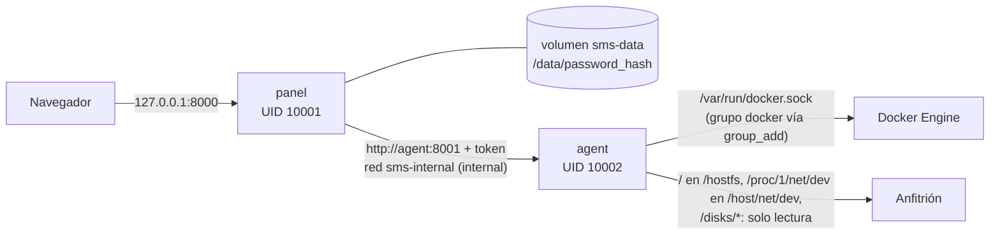

# 8. Guía de desarrollo local

> Estado: **actualizada en la fase de rediseño de interfaz y limpieza (2026-11-16)** con los nombres
> nuevos (`server_monitor`, `panel`, `SMS_*`, `sms-dev`). Los comandos de tests, Compose, contraseña y
> pruebas extremo a extremo se ejecutaron con éxito en la máquina local (ver [07-pruebas.md](07-pruebas.md)).
> La construcción **desde un entorno limpio siguiendo esta guía** y `verify_dev_env.sh` con el entorno
> renombrado están **pendientes de comprobar**. Esta guía cubre solo el entorno de desarrollo local;
> la instalación en el servidor real está pendiente.

**Regla de oro:** todo se ejecuta en tu máquina. Nunca se lanza este entorno contra el servidor real.

## Requisitos

| Herramienta | Versión probada | Para qué |
|---|---|---|
| Linux | CachyOS (kernel 7.3) | Sistema anfitrión |
| Docker Engine | 29.9.2 | Ejecutar panel y agente (API 1.44 o superior) |
| Docker Compose | 5.6.1 | Orquestar el entorno local |
| uv | (la del sistema) | Entorno virtual y dependencias de Python |
| Python | 3.12 (lo descarga uv si hace falta) | Misma versión que las imágenes y el CI |
| Node.js | cualquiera reciente | Solo para `node --check` de los módulos JS (opcional) |
| Chromium | solo para `e2e_ui.py` | Prueba en navegador (opcional) |

Tu usuario debe poder usar Docker (pertenecer al grupo `docker`).

## 1. Instalación desde cero, paso a paso

Desde la raíz del repositorio:

```bash
# 1. Entorno de Python con todas las dependencias (panel + agente + desarrollo)
uv sync --all-extras

# 2. Comprobar que el código está bien antes de levantar nada
uv run ruff check . && uv run ruff format --check .
uv run pytest -q -m "not integration"        # 68 tests, sin Docker

# 3. Preparar los secretos y el GID del socket de Docker (una vez; es idempotente).
#    Crea o actualiza deploy/.env (permisos 600) conservando el resto de líneas.
bash scripts/prepare_dev_env.sh

# 4. Definir la contraseña del panel en deploy/.env (4 a 128 caracteres, sin comillas)
echo 'APP_PASSWORD=pon-aqui-tu-contrasena' >> deploy/.env

# 5. Construir y levantar (panel + agente)
docker compose --env-file deploy/.env -f deploy/compose.dev.yaml up -d --build --wait
```

Abre <http://127.0.0.1:8000> e inicia sesión con el valor de `APP_PASSWORD`. Puedes partir de
`deploy/.env.example`, que documenta las variables. Si te olvidas del paso 4, `docker compose` se niega
a continuar con «Define APP_PASSWORD en deploy/.env»; `prepare_dev_env.sh` también te avisa al final.

### Si existía el entorno antiguo (`minipaas-dev`)

El renombrado cambió el nombre del proyecto Compose, de las redes y del volumen. El entorno antiguo
sigue ocupando el puerto 8000 y hay que **bajarlo antes** de levantar el nuevo:

```bash
docker compose -p minipaas-dev down          # libera el puerto 8000 y quita contenedores y redes
# Opcional, para limpiar del todo lo antiguo (borra sus imágenes locales y su volumen con el hash):
docker compose -p minipaas-dev down --rmi local -v
```

Después sigue los pasos 1 a 5. Como el volumen nuevo (`sms-data`) está vacío, se guardará el hash
de tu `APP_PASSWORD` en el primer arranque. El archivo antiguo `deploy/secrets/controlplane_token` ya no se usa;
puedes borrarlo (el directorio es tuyo). El script de preparación regenera los secretos con los nombres
nuevos si hace falta.

### Establecer o cambiar la contraseña

La contraseña se define **solo** con la variable de entorno `APP_PASSWORD` (en `deploy/.env`; la
variable se pasa al panel desde `compose.dev.yaml`). Al arrancar, el panel guarda únicamente su **hash
Argon2id** en `/data/password_hash` (permisos 600) y nunca escribe la contraseña en disco ni en los
logs. No hay contraseña por defecto. Qué pasa en cada caso:

| Situación al arrancar | Resultado |
|---|---|
| Primera instalación (no hay hash guardado) | Se guarda el hash. Log INFO «Contraseña inicial configurada a partir de APP_PASSWORD» |
| Hay hash y `APP_PASSWORD` coincide | Arranque normal. Log INFO breve |
| Hay hash y `APP_PASSWORD` **no** coincide, sin confirmación | El panel **no arranca** (sale con código 1) y el log explica cómo proceder |
| Hay hash, no coincide y `APP_PASSWORD_RESET=true` | Se sustituye el hash. Log WARNING «Contraseña cambiada por APP_PASSWORD_RESET=true; quita APP_PASSWORD_RESET de deploy/.env» |
| `APP_PASSWORD_RESET=true` pero coincide | Arranque normal con un WARNING: la variable puede quitarse |
| `APP_PASSWORD` ausente, vacía o fuera de 4 a 128 caracteres | El panel no arranca; el log da el motivo (sin mostrar el valor) |

**Cambiar la contraseña** (por ejemplo, a `nueva-clave`):

```bash
# 1. En deploy/.env: pon el valor nuevo en APP_PASSWORD y añade APP_PASSWORD_RESET=true
# 2. Reinicia el panel (recrea el contenedor para que lea el nuevo entorno)
docker compose --env-file deploy/.env -f deploy/compose.dev.yaml up -d --wait
# 3. Cuando arranque, QUITA la línea APP_PASSWORD_RESET de deploy/.env
```

Solo el texto `true` (sin distinguir mayúsculas) cuenta como confirmación; cualquier otro valor se
trata como «no». Si prefieres no cambiarla, restaura el valor anterior de `APP_PASSWORD`. Como las
sesiones están en memoria, **cualquier reinicio del panel (y por tanto cualquier cambio de contraseña)
cierra todas las sesiones abiertas**: hay que volver a iniciar sesión.

**Riesgo conocido:** una variable de entorno se ve con `docker inspect` para quien ya tiene acceso a
Docker (equivalente a root en el anfitrión). Por eso en disco solo hay el hash y `deploy/.env` no se
versiona y debe tener permisos 600 (`prepare_dev_env.sh` los aplica).

### Datos persistentes

El volumen `sms-dev_sms-data` (montado en `/data` del panel) guarda solo el hash de la contraseña.
Sobrevive a `restart`, `down` y reconstrucciones. **Solo `down -v` lo borra** (el siguiente arranque
volverá a guardar el hash de `APP_PASSWORD`). Las sesiones están en memoria: se pierden al reiniciar el panel.

### Apagar

```bash
docker compose --env-file deploy/.env -f deploy/compose.dev.yaml down
```

El proyecto Compose se llama `sms-dev`; `down` solo afecta a sus contenedores y redes.

## 2. Mostrar un disco extra

Por defecto solo se ve el disco raíz («Sistema»). Para que el panel muestre otro disco (por ejemplo, uno
montado en `/mnt/datos` en el anfitrión):

1. Abre `deploy/compose.dev.yaml`, en el servicio `agent`, sección `volumes`, y descomenta o añade:

   ```yaml
   - /mnt/datos:/disks/datos:ro
   ```

   El nombre tras `/disks/` (`datos`) es el que aparecerá en el panel. Siempre con `:ro`.
2. Recrea el agente: `docker compose --env-file deploy/.env -f deploy/compose.dev.yaml up -d agent`.
3. Comprueba que el panel muestra un indicador nuevo con ese nombre.

Condición: el directorio debe ser un **punto de montaje de otro sistema de archivos**. Si está en el mismo
disco que el raíz (mismo `st_dev`), el agente lo omite para no repetir el disco. Cada disco extra se
declara aparte; el agente no descubre discos por su cuenta (ADR-044). Este flujo **no se ha probado con
un disco real**, solo con directorios falsos en los tests.

## 3. Tests y estilo (sin Docker)

```bash
uv run ruff check .                  # errores comunes y reglas de seguridad
uv run ruff format --check .         # formato
uv run pytest -q                     # 68 tests (incluye 3 de integración con Docker local)
uv run pytest -q -m "not integration"  # 65 tests, sin Docker (lo que ejecuta el CI)
for f in $(find src/server_monitor/panel/web/js -name '*.js'); do node --check "$f"; done   # sintaxis JS
```

## 4. Pruebas extremo a extremo

```bash
bash scripts/e2e_monitor.sh          # 32 comprobaciones; proyecto aparte sms-e2e, puerto 8010
```

Necesita haber ejecutado `prepare_dev_env.sh`. Crea contenedores «ajenos» con la CLI de Docker,
comprueba que las métricas coinciden con las del anfitrión (`/proc/meminfo`, `df`, `/etc/os-release`,
coretemp...), que el contenedor se detecta y que, al pararlo, sigue apareciendo como detenido, que las
consultas no generan eventos de modificación en `docker events`, que el panel no tiene el socket, que
`/hostfs` es de solo lectura y sin submontajes, y el flujo de sesión y de bloqueo. Elimina al terminar
sus contenedores, volúmenes e imágenes.

Prueba en navegador (Playwright no es dependencia del proyecto; se descarga con `uvx`; necesita
Chromium, por defecto en `/usr/bin/chromium`, o `CHROMIUM_PATH`). Contra un panel ya levantado y con
contraseña:

```bash
SMS_URL=http://127.0.0.1:8000 APP_PASSWORD='<tu contraseña>' SMS_SCREENSHOTS=/ruta/capturas \
    uvx --with playwright python scripts/e2e_ui.py       # 22 comprobaciones
```

`SMS_SCREENSHOTS` es opcional (guarda capturas). Para no tocar tu entorno de desarrollo se puede usar un
proyecto Compose aparte (p. ej. `-p sms-ui` con `SMS_PORT=8011`).

`scripts/verify_dev_env.sh` comprueba el aislamiento del entorno (12 comprobaciones: panel sin socket,
agente sin puertos, ningún contenedor como root, secretos 600/700, `/data` escribible, raíz de solo
lectura...). **Pendiente de reejecutar con los nombres nuevos.**

## 5. Qué se levanta



| Contenedor | Puertos | Redes | Socket Docker | Protecciones |
|---|---|---|---|---|
| `panel` | `127.0.0.1:8000` (configurable con `SMS_PORT`) | `sms-internal`, `sms-public` | No | no root, `read_only` (salvo `/data`), `cap_drop: ALL`, `no-new-privileges` |
| `agent` | Ninguno | Solo `sms-internal` (sin salida a Internet) | Sí | Las mismas + token obligatorio + montajes del anfitrión de solo lectura |

Las variables de entorno están descritas en [04-backend.md](04-backend.md), apartado 4.9.

## 6. Archivos locales que no se versionan

| Archivo | Lo crea | Contenido |
|---|---|---|
| `deploy/secrets/` | `prepare_dev_env.sh` | Directorio con permisos **700** |
| `deploy/secrets/panel_token` | `prepare_dev_env.sh` | Token aleatorio (64 caracteres), permisos **600**, propietario UID **10001** |
| `deploy/secrets/agent_token` | `prepare_dev_env.sh` | El **mismo** token, permisos **600**, propietario UID **10002** |
| `deploy/.env` | `prepare_dev_env.sh` | `DOCKER_GID` (grupo propietario del socket de Docker) |
| `.venv/` | `uv sync --all-extras` | Entorno virtual |

Por qué dos copias del token: Compose, sin Swarm, monta cada *secret* con el propietario y los permisos
del archivo del host e ignora `uid`/`gid`/`mode`. Para que un archivo `600` sea legible dentro del
contenedor, su propietario tiene que ser el UID del proceso, y los dos componentes tienen UID distintos
(ADR-014). El script asigna el propietario mediante un contenedor efímero sin red, de modo que no hace
falta `sudo`.

- **Tu usuario no puede leer el token** (`cat` da «Permiso denegado»). Es lo esperado.
- Sí puedes borrarlo, porque el directorio es tuyo. Para cambiar el token:
  `bash scripts/prepare_dev_env.sh --rotate` y reinicia el entorno.

## 7. Dependencias

Las dependencias se agrupan por componente en `pyproject.toml`: comunes (FastAPI, Uvicorn), extra `panel`
(HTTPX, argon2-cffi) y extra `agent` (SDK de Docker). Así la imagen del agente no lleva código que no
usa. En desarrollo se instalan todas con `uv sync --all-extras`. El panel no usa ninguna librería de
JavaScript; las fuentes y los iconos son archivos estáticos incluidos en el repositorio.

`uv.lock` fija las versiones exactas. Las imágenes Docker no usan `uv`: instalan
`deploy/requirements/panel.txt` y `deploy/requirements/agent.txt`, exportados de `uv.lock` con los hashes
SHA-256 (`pip install --require-hashes`). Tras añadir o actualizar una dependencia:

```bash
uv add <paquete>                      # o uv lock --upgrade-package <paquete>
bash scripts/export_requirements.sh   # regenera deploy/requirements/*.txt
```

El CI falla si `deploy/requirements/` no coincide con `uv.lock`.

## 8. Convenciones de código

- Identificadores en **inglés**; docstrings y comentarios en **español**, explicando el porqué.
- Funciones cortas y con una responsabilidad; sin capas que no aporten.
- `ruff` (incluidas las reglas `S` de seguridad) debe pasar sin errores; las excepciones se justifican en
  un comentario.
- Las factorías `create_app(...)` reciben sus dependencias (cliente del agente, cliente de Docker) para
  poder probarlas con dobles; `build_app_from_env()` es el único punto que lee el entorno real.
- En el panel: datos siempre con `textContent`, nunca con `innerHTML`; sin CDN ni estilos en línea
  (CSP `default-src 'self'`).

## 9. Problemas frecuentes

| Síntoma | Causa probable | Solución |
|---|---|---|
| `port is already allocated` / el puerto 8000 está ocupado | Sigue levantado el entorno antiguo `minipaas-dev` (o `sms-dev` en otro directorio) | `docker compose -p minipaas-dev down` y vuelve a levantar |
| `DOCKER_GID ... Define DOCKER_GID en deploy/.env` | No se ha ejecutado el script de preparación | `bash scripts/prepare_dev_env.sh` |
| El contenedor sale con un error del token | Faltan los archivos de `deploy/secrets/` o tienen otro propietario | `bash scripts/prepare_dev_env.sh` (los regenera si no son correctos) |
| El CI falla en «deploy/requirements está sincronizado» | Se cambió `uv.lock` sin exportar | `bash scripts/export_requirements.sh` y confirma los cambios |
| `docker compose` dice «Define APP_PASSWORD en deploy/.env» | Falta `APP_PASSWORD` en `deploy/.env` (o está vacía) | Añádela (4 a 128 caracteres) y vuelve a levantar |
| El panel no arranca y el log dice «Falta APP_PASSWORD» o «APP_PASSWORD no es válida» | Variable vacía, o con menos de 4 o más de 128 caracteres | Corrige el valor en `deploy/.env`; `docker compose ... logs panel` muestra el motivo |
| El panel no arranca y el log dice «APP_PASSWORD no coincide con la contraseña ya configurada» | Cambiaste `APP_PASSWORD` sin confirmarlo | Restaura el valor anterior, o añade `APP_PASSWORD_RESET=true`, reinicia y quítala |
| Tras cambiar la contraseña sigues viendo avisos «APP_PASSWORD_RESET» en el log | Olvidaste quitar `APP_PASSWORD_RESET` de `deploy/.env` | Quita la línea; el aviso desaparece en el siguiente arranque |
| La contraseña con `$`, comillas o espacios no funciona | Compose interpreta `$` y comillas en `.env` | Evítalos en la contraseña o duplica el `$` (`$$`) |
| El login responde 503 «No hay contraseña configurada» | Situación defensiva que no debería darse (el archivo de hash desapareció con el panel en marcha) | Reinicia el panel: volverá a guardar el hash de `APP_PASSWORD` |
| El panel muestra «Agente sin respuesta» | El agente está parado o Docker no responde | `docker compose ... ps` y `logs agent` |
| Docker no disponible con el agente funcionando | El agente no puede usar el socket (GID incorrecto) | Vuelve a ejecutar el script de preparación y reinicia |
| La red no aparece o la gráfica de red está oculta | El agente no puede leer `/host/net/dev` (falta el montaje de `/proc/1/net/dev`) | Comprueba el volumen en `compose.dev.yaml` |
| La temperatura dice «No disponible» | El equipo no tiene `coretemp`, `k10temp` ni `x86_pkg_temp` (p. ej. algunas máquinas virtuales o ARM) | Es lo esperado: no se inventa un valor |
| Un disco extra no aparece | El directorio está en el mismo sistema de archivos que el raíz, o no está montado | Ver apartado 2 |
| «Demasiados intentos fallidos» al iniciar sesión | 5 fallos en 15 minutos desde esa IP | Espera a que pase la ventana o reinicia el panel (el contador está en memoria) |
| `ModuleNotFoundError: argon2` o `docker` al ejecutar los tests | Se instaló el entorno sin extras | `uv sync --all-extras` |
| Hay que volver a entrar tras reiniciar | Las sesiones están en memoria | Es lo esperado (ADR-039) |
| Las gráficas empiezan vacías tras recargar | El histórico vive en la memoria del navegador | Es lo esperado (ADR-047) |
