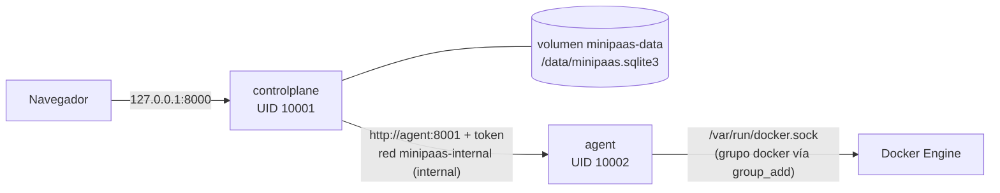

# Guía de desarrollo local

> Estado: **implementado y verificado** en las Fases 1 y 2 (2026-11-15). La Fase 2 añade la base de
> datos persistente, el administrador y la prueba extremo a extremo. Esta guía cubre solo el entorno de
> desarrollo local. La instalación en el servidor se documentará en la Fase 13.

**Regla de oro:** todo se ejecuta en tu máquina. Nunca se lanza este entorno contra el servidor real.

## Requisitos

| Herramienta | Versión probada | Para qué |
|---|---|---|
| Linux | CachyOS (kernel 7.3) | Sistema anfitrión |
| Docker Engine | 29.9.2 | Ejecutar control plane y agente |
| Docker Compose | 5.6.1 | Orquestar el entorno local |
| uv | (la del sistema) | Entorno virtual y dependencias de Python |
| Python | 3.12 (lo descarga uv si hace falta) | Misma versión que las imágenes y el CI |

Tu usuario debe poder usar Docker (pertenecer al grupo `docker`).

## 1. Tests y estilo (sin Docker)

```bash
uv sync --all-extras                           # .venv con las dependencias de control plane, agente y desarrollo
uv run ruff check .                            # errores comunes y reglas de seguridad (bandit)
uv run ruff format --check .                   # formato
uv run pytest -m "not integration" --cov=minipaas   # tests unitarios y de API
uv run pytest -m integration                   # tests contra el Docker local (solo lectura)
```

## 2. Levantar el entorno con Docker

```bash
bash scripts/prepare_dev_env.sh   # crea los tokens (600) y deploy/.env; idempotente
docker compose --env-file deploy/.env -f deploy/compose.dev.yaml up -d --build --wait
```

Abre <http://127.0.0.1:8000>. La primera vez el panel indica que no existe ningún administrador.

### Crear el administrador (una sola vez)

```bash
docker compose --env-file deploy/.env -f deploy/compose.dev.yaml \
    exec controlplane python -m minipaas.controlplane.manage create-admin --username admin
```

Pide la contraseña dos veces (12–128 caracteres) sin mostrarla. No existe ninguna contraseña por
defecto, y la contraseña nunca se pasa como argumento (quedaría en el historial y en `ps`). Si ya
existe un administrador, la orden termina con error y **no modifica nada**. Para automatizarlo se
puede usar `--password-stdin` (lee una línea de la entrada estándar).

Otras órdenes de administración:

```bash
docker compose ... exec controlplane python -m minipaas.controlplane.manage db-version   # versión del esquema
docker compose ... exec controlplane python -m minipaas.controlplane.manage migrate      # aplicar migraciones
```

Las migraciones también se aplican automáticamente al arrancar el control plane.

### Datos persistentes

La base de datos SQLite está en el volumen con nombre `minipaas-dev_minipaas-data`, montado en `/data`
dentro del control plane. Sobrevive a `restart`, `down` y reconstrucciones de imagen. **Solo
`down -v` lo borra** (y con él el administrador y las aplicaciones registradas).

Para comprobar automáticamente las propiedades de aislamiento:

```bash
bash scripts/verify_dev_env.sh          # levanta el entorno y comprueba 12 propiedades
bash scripts/verify_dev_env.sh --down   # igual, y lo apaga al terminar
```

Para apagarlo:

```bash
docker compose --env-file deploy/.env -f deploy/compose.dev.yaml down
```

El proyecto Compose se llama `minipaas-dev`; `down` solo afecta a sus contenedores y redes.

### Prueba extremo a extremo

```bash
bash scripts/e2e_phase2.sh
```

Levanta un proyecto Compose **separado** (`minipaas-e2e`, puerto 8010) para no tocar tu base de datos
de desarrollo, y comprueba: creación del administrador (y que no se sobrescribe), login, 401 sin
sesión, 403 sin token CSRF, alta de una aplicación, persistencia tras `down`/`up`, cierre de sesión y
rechazo de la cookie antigua. Al terminar elimina sus contenedores, volúmenes e imágenes.

## 3. Qué se levanta



| Contenedor | Puertos | Redes | Socket Docker | Protecciones |
|---|---|---|---|---|
| `controlplane` | `127.0.0.1:8000` (configurable con `MINIPAAS_PORT`) | `minipaas-internal`, `minipaas-public` | No | no root, `read_only` (salvo el volumen `/data`), `cap_drop: ALL`, `no-new-privileges` |
| `agent` | Ninguno | Solo `minipaas-internal` (sin salida a Internet) | Sí | Las mismas + token obligatorio |

## 4. Archivos locales que no se versionan

| Archivo | Lo crea | Contenido |
|---|---|---|
| `deploy/secrets/` | `prepare_dev_env.sh` | Directorio con permisos **700** |
| `deploy/secrets/controlplane_token` | `prepare_dev_env.sh` | Token aleatorio (64 caracteres), permisos **600**, propietario UID **10001** |
| `deploy/secrets/agent_token` | `prepare_dev_env.sh` | El **mismo** token, permisos **600**, propietario UID **10002** |
| `deploy/.env` | `prepare_dev_env.sh` | `DOCKER_GID` (grupo propietario del socket de Docker) |
| `.venv/` | `uv sync --all-extras` | Entorno virtual |

Por qué dos copias del token: Compose, sin Swarm, monta cada *secret* con el propietario y los permisos
del archivo del host e ignora `uid`/`gid`/`mode`. Para que un archivo `600` sea legible dentro del
contenedor, su propietario tiene que ser el UID del proceso, y los dos componentes tienen UID
distintos (ADR-014). El script asigna el propietario mediante un contenedor efímero sin red, de modo
que no hace falta `sudo`.

Consecuencias prácticas:

- **Tu usuario no puede leer el token** (`cat` da «Permiso denegado»). Es lo esperado.
- Sí puedes borrarlo, porque el directorio es tuyo. Para cambiar el token:
  `bash scripts/prepare_dev_env.sh --rotate` y reinicia el entorno.
- Si los archivos no tienen los permisos o propietarios correctos (por ejemplo, de una versión
  anterior con `644`), el script los regenera automáticamente.

## 5. Dependencias

Las dependencias se agrupan por componente en `pyproject.toml`: comunes (FastAPI, Uvicorn), extra
`controlplane` (HTTPX, argon2-cffi) y extra `agent` (SDK de Docker). Así la imagen del agente no lleva
código que no usa. En desarrollo se instalan todas con `uv sync --all-extras`.

`uv.lock` fija las versiones exactas de todas las dependencias. Las imágenes Docker no usan `uv`:
instalan `deploy/requirements/controlplane.txt` y `deploy/requirements/agent.txt`, exportados de
`uv.lock` con los hashes SHA-256 de cada paquete (`pip install --require-hashes`). Tras añadir o
actualizar una dependencia:

```bash
uv add <paquete>                      # o uv lock --upgrade-package <paquete>
bash scripts/export_requirements.sh   # regenera deploy/requirements/*.txt
```

El CI falla si `deploy/requirements/` no coincide con `uv.lock`.

## 6. Convenciones de código

- Identificadores en **inglés**; docstrings y comentarios en **español**, explicando el porqué.
- Funciones cortas y con una responsabilidad; sin capas que no aporten.
- `ruff` (incluidas las reglas `S` de seguridad) debe pasar sin errores; las excepciones se
  justifican en un comentario.
- Las factorías `create_app(...)` reciben sus dependencias (cliente del agente, runtime de Docker)
  para poder probarlas con dobles; `build_app_from_env()` es el único punto que lee el entorno real.
- En el panel: datos siempre con `textContent`, nunca con `innerHTML`; sin CDN.

## 7. Problemas frecuentes

| Síntoma | Causa probable | Solución |
|---|---|---|
| `DOCKER_GID ... Define DOCKER_GID en deploy/.env` | No se ha ejecutado el script de preparación | `bash scripts/prepare_dev_env.sh` |
| El contenedor sale con un error del token | Faltan los archivos de `deploy/secrets/` o tienen otro propietario | `bash scripts/prepare_dev_env.sh` (los regenera si no son correctos) |
| El CI falla en «deploy/requirements está sincronizado» | Se cambió `uv.lock` sin exportar | `bash scripts/export_requirements.sh` y confirma los cambios |
| El panel muestra «Agente: No disponible» | El agente está parado | `docker compose ... ps` y `logs agent` |
| El panel muestra «Docker: No disponible» con el agente funcionando | El agente no puede usar el socket (GID incorrecto) | Vuelve a ejecutar el script de preparación y reinicia |
| El panel dice que no existe ningún administrador | Base de datos nueva (o se hizo `down -v`) | Crea el administrador (apartado 2) |
| «Demasiados intentos fallidos» al iniciar sesión | 5 fallos en 15 minutos desde esa IP o con ese usuario | Espera a que pase la ventana o reinicia el control plane (el contador está en memoria) |
| `ModuleNotFoundError: argon2` o `docker` al ejecutar los tests | Se instaló el entorno sin extras | `uv sync --all-extras` |
| `create-admin` responde «Ya existe un administrador» | Ya se creó antes | Es el comportamiento esperado: nunca se sobrescribe |
