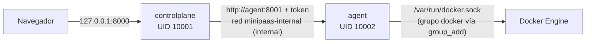

# Guía de desarrollo local

> Estado: **implementado y verificado en la Fase 1** (2026-11-15). Esta guía cubre solo el entorno de
> desarrollo local. La instalación en el servidor se documentará en la Fase 13.

**Regla de oro:** todo se ejecuta en tu máquina. Nunca se lanza este entorno contra el servidor real.

## Requisitos

| Herramienta | Versión probada | Para qué |
|---|---|---|
| Linux | CachyOS (kernel 7.3) | Sistema anfitrión |
| Docker Engine | 29.9.2 | Ejecutar control plane y agente |
| Docker Compose | 5.6.1 | Orquestar el entorno local |
| uv | (la del sistema) | Entorno virtual y dependencias de Python |
| Python | 3.12 (lo descarga uv si hace falta) | Misma versión que las imágenes y el CI |

Tu usuario debe poder usar Docker (pertenecer al grupo `docker`).

## 1. Tests y estilo (sin Docker)

```bash
uv sync                                        # crea .venv con dependencias y herramientas de desarrollo
uv run ruff check .                            # errores comunes y reglas de seguridad (bandit)
uv run ruff format --check .                   # formato
uv run pytest -m "not integration" --cov=minipaas   # tests unitarios y de API
uv run pytest -m integration                   # tests contra el Docker local (solo lectura)
```

## 2. Levantar el entorno con Docker

```bash
bash scripts/prepare_dev_env.sh   # crea deploy/secrets/agent_token y deploy/.env (una vez)
docker compose --env-file deploy/.env -f deploy/compose.dev.yaml up -d --build --wait
```

Abre <http://127.0.0.1:8000>: el panel muestra el estado del control plane, del agente y de Docker.

Para comprobar automáticamente las propiedades de aislamiento:

```bash
bash scripts/verify_dev_env.sh          # levanta el entorno y comprueba 7 propiedades
bash scripts/verify_dev_env.sh --down   # igual, y lo apaga al terminar
```

Para apagarlo:

```bash
docker compose --env-file deploy/.env -f deploy/compose.dev.yaml down
```

El proyecto Compose se llama `minipaas-dev`; `down` solo afecta a sus contenedores y redes.

## 3. Qué se levanta



| Contenedor | Puertos | Redes | Socket Docker | Protecciones |
|---|---|---|---|---|
| `controlplane` | `127.0.0.1:8000` | `minipaas-internal`, `minipaas-public` | No | no root, `read_only`, `cap_drop: ALL`, `no-new-privileges` |
| `agent` | Ninguno | Solo `minipaas-internal` (sin salida a Internet) | Sí | Las mismas + token obligatorio |

## 4. Archivos locales que no se versionan

| Archivo | Lo crea | Contenido |
|---|---|---|
| `deploy/secrets/agent_token` | `prepare_dev_env.sh` | Token aleatorio compartido (64 caracteres). Directorio con permisos 700 |
| `deploy/.env` | `prepare_dev_env.sh` | `DOCKER_GID` (grupo propietario del socket de Docker) |
| `.venv/` | `uv sync` | Entorno virtual |

Si borras el token, el script genera uno nuevo; reinicia el entorno para que lo usen ambos procesos.

## 5. Convenciones de código

- Identificadores en **inglés**; docstrings y comentarios en **español**, explicando el porqué.
- Funciones cortas y con una responsabilidad; sin capas que no aporten.
- `ruff` (incluidas las reglas `S` de seguridad) debe pasar sin errores; las excepciones se
  justifican en un comentario.
- Las factorías `create_app(...)` reciben sus dependencias (cliente del agente, runtime de Docker)
  para poder probarlas con dobles; `build_app_from_env()` es el único punto que lee el entorno real.
- En el panel: datos siempre con `textContent`, nunca con `innerHTML`; sin CDN.

## 6. Problemas frecuentes

| Síntoma | Causa probable | Solución |
|---|---|---|
| `DOCKER_GID ... Define DOCKER_GID en deploy/.env` | No se ha ejecutado el script de preparación | `bash scripts/prepare_dev_env.sh` |
| El contenedor sale con un error del token | Falta `deploy/secrets/agent_token` o es ilegible | Ejecuta el script de preparación |
| El panel muestra «Agente: No disponible» | El agente está parado | `docker compose ... ps` y `logs agent` |
| El panel muestra «Docker: No disponible» con el agente funcionando | El agente no puede usar el socket (GID incorrecto) | Vuelve a ejecutar el script de preparación y reinicia |
