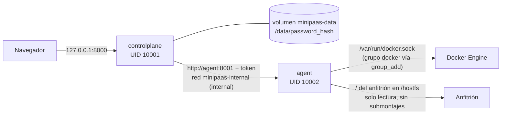

# Guía de desarrollo local

> Estado: **actualizada en la renovación (2026-11-16)**. Los comandos de tests, Compose, contraseña y
> pruebas extremo a extremo se ejecutaron con éxito en la máquina local (ver `registro-pruebas.md`).
> Esta guía cubre solo el entorno de desarrollo local; la instalación en el servidor está pendiente.

**Regla de oro:** todo se ejecuta en tu máquina. Nunca se lanza este entorno contra el servidor real.

## Requisitos

| Herramienta | Versión probada | Para qué |
|---|---|---|
| Linux | CachyOS (kernel 7.3) | Sistema anfitrión |
| Docker Engine | 29.9.2 | Ejecutar panel y agente (API 1.44 o superior) |
| Docker Compose | 5.6.1 | Orquestar el entorno local |
| uv | (la del sistema) | Entorno virtual y dependencias de Python |
| Python | 3.12 (lo descarga uv si hace falta) | Misma versión que las imágenes y el CI |
| Chromium | solo para `e2e_ui.py` | Prueba en navegador (opcional) |

Tu usuario debe poder usar Docker (pertenecer al grupo `docker`).

## 1. Tests y estilo (sin Docker)

```bash
uv sync --all-extras                 # .venv con todas las dependencias
uv run ruff check .                  # errores comunes y reglas de seguridad
uv run ruff format --check .         # formato
uv run pytest -q                     # 48 tests (incluye 3 de integración con Docker local)
uv run pytest -q -m "not integration"  # 45 tests, sin Docker (lo que ejecuta el CI)
```

## 2. Levantar el entorno con Docker

```bash
bash scripts/prepare_dev_env.sh   # crea los tokens (600) y deploy/.env; idempotente
docker compose --env-file deploy/.env -f deploy/compose.dev.yaml up -d --build --wait
```

### Establecer la contraseña del panel

```bash
docker compose --env-file deploy/.env -f deploy/compose.dev.yaml \
    exec controlplane python -m minipaas.controlplane.manage set-password
```

Pide la contraseña dos veces (4 a 128 caracteres) sin mostrarla y guarda su hash Argon2id en
`/data/password_hash`. No hay contraseña por defecto, y nunca se pasa como argumento (quedaría en el
historial y en `ps`). Para scripts: `printf '%s\n' "$PASSWORD" | docker compose ... exec -T
controlplane python -m minipaas.controlplane.manage set-password --stdin`. Ejecutarla de nuevo
**cambia** la contraseña (las sesiones abiertas siguen válidas hasta que caduquen o se reinicie el
panel).

Abre <http://127.0.0.1:8000>. Hasta que se establezca la contraseña, el login responde 503.

### Datos persistentes

El volumen `minipaas-dev_minipaas-data` (montado en `/data` del panel) guarda solo el hash de la
contraseña. Sobrevive a `restart`, `down` y reconstrucciones. **Solo `down -v` lo borra** (y habrá
que volver a ejecutar `set-password`). Las sesiones están en memoria: se pierden al reiniciar el panel.

### Apagar

```bash
docker compose --env-file deploy/.env -f deploy/compose.dev.yaml down
```

El proyecto Compose se llama `minipaas-dev`; `down` solo afecta a sus contenedores y redes.

### Pruebas extremo a extremo

```bash
bash scripts/e2e_monitor.sh          # 29 comprobaciones; proyecto aparte minipaas-e2e, puerto 8010
```

Crea un contenedor «ajeno» con la CLI de Docker, comprueba que las métricas coinciden con las del
anfitrión (`/proc/meminfo`, `df`, `/etc/os-release`...), que el contenedor se detecta y deja de
aparecer al pararlo, que las consultas no generan eventos de modificación en `docker events`, que el
panel no tiene el socket, que `/hostfs` es de solo lectura y sin submontajes, y el flujo de sesión y
de bloqueo. Elimina al terminar sus contenedores, volúmenes e imágenes.

Prueba en navegador (Playwright no es dependencia del proyecto; se descarga con `uvx` al ejecutarla;
necesita Chromium, por defecto en `/usr/bin/chromium`, o `CHROMIUM_PATH`). Contra un panel ya
levantado y con contraseña:

```bash
MINIPAAS_URL=http://127.0.0.1:8000 MINIPAAS_PASSWORD='<tu contraseña>' \
    uvx --with playwright python scripts/e2e_ui.py       # 11 comprobaciones
```

Para no tocar tu entorno de desarrollo se puede usar un proyecto Compose aparte (p. ej.
`-p minipaas-ui` con `MINIPAAS_PORT=8011`), como se hizo en el registro de pruebas.

`scripts/verify_dev_env.sh` viene de la etapa anterior y **no se ha vuelto a ejecutar** en la
renovación (reconstruir el entorno `minipaas-dev` quedó bloqueado por los permisos del modo
automático). Sus comprobaciones de seguridad están cubiertas solo en parte por `e2e_monitor.sh`.
Está pendiente reejecutarlo y, si hace falta, adaptarlo.

## 3. Qué se levanta



| Contenedor | Puertos | Redes | Socket Docker | Protecciones |
|---|---|---|---|---|
| `controlplane` | `127.0.0.1:8000` (configurable con `MINIPAAS_PORT`) | `minipaas-internal`, `minipaas-public` | No | no root, `read_only` (salvo `/data`), `cap_drop: ALL`, `no-new-privileges` |
| `agent` | Ninguno | Solo `minipaas-internal` (sin salida a Internet) | Sí | Las mismas + token obligatorio + `/hostfs` de solo lectura |

### Variables de entorno

| Componente | Variable | Valor por defecto / en Compose |
|---|---|---|
| Panel | `MINIPAAS_AGENT_TOKEN_FILE` | `/run/secrets/controlplane_token` |
| Panel | `MINIPAAS_AGENT_URL` | `http://agent:8001` |
| Panel | `MINIPAAS_PASSWORD_HASH_FILE` | `/data/password_hash` |
| Panel | `MINIPAAS_COOKIE_SECURE` | `false` (poner `true` con HTTPS) |
| Agente | `MINIPAAS_AGENT_TOKEN_FILE` | `/run/secrets/agent_token` |
| Agente | `MINIPAAS_HOSTFS` | `/` por defecto; `/hostfs` en Compose |

`MINIPAAS_DB_PATH` se eliminó con SQLite.

## 4. Archivos locales que no se versionan

| Archivo | Lo crea | Contenido |
|---|---|---|
| `deploy/secrets/` | `prepare_dev_env.sh` | Directorio con permisos **700** |
| `deploy/secrets/controlplane_token` | `prepare_dev_env.sh` | Token aleatorio (64 caracteres), permisos **600**, propietario UID **10001** |
| `deploy/secrets/agent_token` | `prepare_dev_env.sh` | El **mismo** token, permisos **600**, propietario UID **10002** |
| `deploy/.env` | `prepare_dev_env.sh` | `DOCKER_GID` (grupo propietario del socket de Docker) |
| `.venv/` | `uv sync --all-extras` | Entorno virtual |

Por qué dos copias del token: Compose, sin Swarm, monta cada *secret* con el propietario y los permisos
del archivo del host e ignora `uid`/`gid`/`mode`. Para que un archivo `600` sea legible dentro del
contenedor, su propietario tiene que ser el UID del proceso, y los dos componentes tienen UID
distintos (ADR-014). El script asigna el propietario mediante un contenedor efímero sin red, de modo
que no hace falta `sudo`.

Consecuencias prácticas:

- **Tu usuario no puede leer el token** (`cat` da «Permiso denegado»). Es lo esperado.
- Sí puedes borrarlo, porque el directorio es tuyo. Para cambiar el token:
  `bash scripts/prepare_dev_env.sh --rotate` y reinicia el entorno.
- Si los archivos no tienen los permisos o propietarios correctos (por ejemplo, de una versión
  anterior con `644`), el script los regenera automáticamente.

## 5. Dependencias

Las dependencias se agrupan por componente en `pyproject.toml`: comunes (FastAPI, Uvicorn), extra
`controlplane` (HTTPX, argon2-cffi) y extra `agent` (SDK de Docker). La renovación no añade ni elimina ninguna. Así la imagen del agente no lleva
código que no usa. En desarrollo se instalan todas con `uv sync --all-extras`.

`uv.lock` fija las versiones exactas de todas las dependencias. Las imágenes Docker no usan `uv`:
instalan `deploy/requirements/controlplane.txt` y `deploy/requirements/agent.txt`, exportados de
`uv.lock` con los hashes SHA-256 de cada paquete (`pip install --require-hashes`). Tras añadir o
actualizar una dependencia:

```bash
uv add <paquete>                      # o uv lock --upgrade-package <paquete>
bash scripts/export_requirements.sh   # regenera deploy/requirements/*.txt
```

El CI falla si `deploy/requirements/` no coincide con `uv.lock`.

## 6. Convenciones de código

- Identificadores en **inglés**; docstrings y comentarios en **español**, explicando el porqué.
- Funciones cortas y con una responsabilidad; sin capas que no aporten.
- `ruff` (incluidas las reglas `S` de seguridad) debe pasar sin errores; las excepciones se
  justifican en un comentario.
- Las factorías `create_app(...)` reciben sus dependencias (cliente del agente, cliente de Docker)
  para poder probarlas con dobles; `build_app_from_env()` es el único punto que lee el entorno real.
- En el panel: datos siempre con `textContent`, nunca con `innerHTML`; sin CDN.

## 7. Problemas frecuentes

| Síntoma | Causa probable | Solución |
|---|---|---|
| `DOCKER_GID ... Define DOCKER_GID en deploy/.env` | No se ha ejecutado el script de preparación | `bash scripts/prepare_dev_env.sh` |
| El contenedor sale con un error del token | Faltan los archivos de `deploy/secrets/` o tienen otro propietario | `bash scripts/prepare_dev_env.sh` (los regenera si no son correctos) |
| El CI falla en «deploy/requirements está sincronizado» | Se cambió `uv.lock` sin exportar | `bash scripts/export_requirements.sh` y confirma los cambios |
| El login responde 503 «No hay contraseña configurada» | No se ha ejecutado `set-password` (o se hizo `down -v`) | Ejecuta `set-password` (apartado 2) |
| El panel muestra «No se pudo actualizar» | El agente está parado o Docker no responde | `docker compose ... ps` y `logs agent` |
| Docker no disponible con el agente funcionando | El agente no puede usar el socket (GID incorrecto) | Vuelve a ejecutar el script de preparación y reinicia |
| «Demasiados intentos fallidos» al iniciar sesión | 5 fallos en 15 minutos desde esa IP | Espera a que pase la ventana o reinicia el panel (el contador está en memoria) |
| `ModuleNotFoundError: argon2` o `docker` al ejecutar los tests | Se instaló el entorno sin extras | `uv sync --all-extras` |
| Hay que volver a entrar tras reiniciar | Las sesiones están en memoria | Es lo esperado (ADR-039) |
