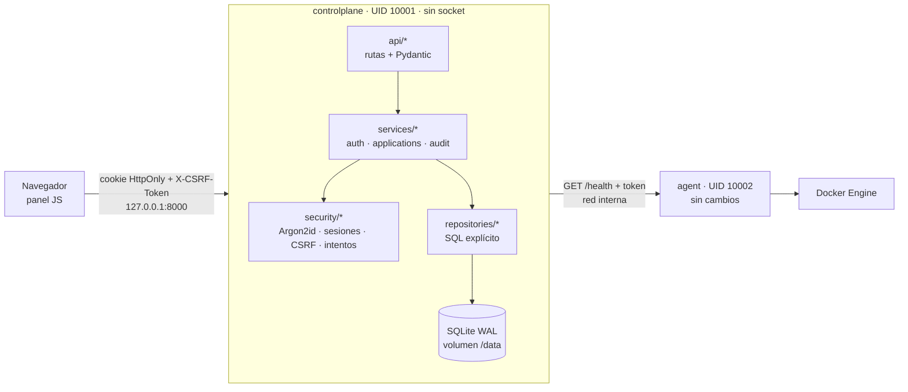
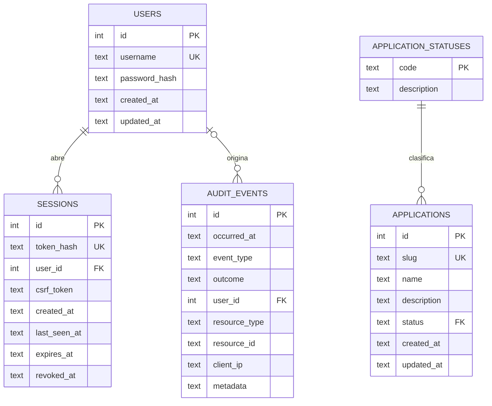

# Informe de cierre — Fase 2: Persistencia, aplicaciones, autenticación y auditoría

> **Informe histórico (etapa PaaS, 2026-11-15).** Se escribió cuando el proyecto se llamaba MiniPaaS
> (paquete `minipaas`, `control plane`, SQLite) y conserva los nombres y rutas de su época: los documentos
> que cita (`docs/api.md`, `docs/decisiones.md`, `docs/registro-pruebas.md`...) hoy están renombrados o
> archivados en `docs/historico/`. No describe el sistema actual; ver [../../README.md](../../README.md).

> Informe autocontenido para Gemini (memoria académica y presentación).
> Proyecto: **MiniPaaS** — *«Diseño e implementación de una plataforma PaaS ligera para el despliegue
> y gestión de aplicaciones distribuidas»*. Asignatura: GSASD. Fecha: **2026-11-15**.
> Estado: **terminada y verificada; pendiente de aprobación del equipo.**

Leyenda usada en todo el informe: **Diseñado** (decidido y documentado), **Implementado** (código
escrito), **Verificado** (prueba ejecutada con resultado real), **Pendiente** (no hecho).

---

## 1. Objetivo y alcance

Construir la primera capa funcional de gestión de MiniPaaS, todavía **sin Docker**: persistencia en
SQLite con migraciones, modelo de aplicaciones, autenticación de un único administrador con sesiones
seguras, protección CSRF, auditoría y un panel con inicio de sesión y gestión de aplicaciones. La fase
prepara la arquitectura para que la Fase 3 añada el despliegue real.

Límites respetados: el control plane sigue sin acceso al socket de Docker; no se ha añadido ninguna
operación Docker; el agente no ha cambiado (salvo que su imagen ya no incluye dependencias que no
usa); todo se ha probado en local; no se ha hecho *push*.

---

## 2. Funcionalidades implementadas (y verificadas)

| Funcionalidad | Estado |
|---|---|
| Base de datos SQLite persistente en un volumen con nombre (`/data`) | Implementado y verificado (persiste a `down`/`up`: E2E) |
| Migraciones versionadas propias con tabla `schema_migrations`, atómicas e idempotentes | Implementado y verificado |
| Detección de versión; rechazo de una base de datos más nueva que el código | Implementado y verificado |
| Claves foráneas, `CHECK`, `busy_timeout`, WAL, transacciones `BEGIN IMMEDIATE` | Implementado y verificado |
| Modelo de aplicaciones: alta, consulta, lista, edición (nombre y descripción), borrado | Implementado y verificado |
| Slug derivado del nombre, validado e inmutable; detección de duplicados (409) | Implementado y verificado |
| Estado lógico `draft` («Sin desplegar») en tabla de códigos | Implementado y verificado |
| Administrador único creado por CLI (`manage create-admin`), sin credenciales por defecto, idempotente | Implementado y verificado |
| Contraseñas con Argon2id, verificación con hash ficticio si el usuario no existe | Implementado y verificado |
| Sesiones en servidor: identificador de 256 bits guardado como SHA-256, caducidad absoluta (8 h) y por inactividad (30 min), revocación, renovación en cada login | Implementado y verificado |
| Cookie `HttpOnly`, `SameSite=Strict`, `Path=/`, `Max-Age`; `Secure` configurable | Implementado y verificado |
| Límite de intentos: 5 fallos en 15 min por IP o usuario → 429 con `Retry-After` | Implementado y verificado |
| CSRF: token sincronizador por sesión en `X-CSRF-Token` + rechazo de `Origin` ajeno | Implementado y verificado |
| Auditoría transaccional (login, fallo de login, logout, alta de administrador, alta/edición/borrado de aplicaciones, migraciones) sin secretos | Implementado y verificado |
| API REST documentada en `docs/api.md` | Implementado y verificado |
| Panel: login, navegación, lista con estado vacío, alta con validación, detalle, edición, borrado con confirmación, cierre de sesión, manejo de 401 | Implementado y verificado en navegador (Chromium *headless*) |
| `scripts/e2e_phase2.sh` y 2 comprobaciones nuevas en `verify_dev_env.sh` | Implementado y verificado |

## 3. Funcionalidades no implementadas (a propósito)

| No implementado | Motivo |
|---|---|
| Despliegues, servicios, volúmenes y cualquier operación Docker | Fase 3 en adelante; sus tablas se crearán con su funcionalidad |
| Estados de ejecución de aplicaciones | No existen despliegues; no se inventan estados |
| Registro público, varios usuarios, roles | Decisión aprobada: un único administrador (ADR-010) |
| Cambio y recuperación de contraseña del administrador | No pedido en esta fase. **Pendiente**: si se olvida la contraseña, hoy solo se puede borrar la base de datos. Se propone `manage reset-password` en una fase posterior |
| Vista de auditoría en el panel | Los eventos se registran y se prueban, pero no se muestran en la interfaz. Pendiente (posible en la Fase 8 o 10) |
| Cifrado en reposo de la base de datos | Fuera de alcance; riesgo documentado |
| Revocación de todas las sesiones desde la interfaz | Existe en el servicio (`revoke_all_for_user`), sin ruta ni botón |

---

## 4. Arquitectura final



Cambios arquitectónicos relevantes:

1. **Capas dentro del control plane**: rutas (HTTP) → servicios (casos de uso y transacciones) →
   repositorios (SQL). Las rutas no contienen SQL; los repositorios no deciden transacciones.
2. **Persistencia** en un volumen con nombre; el sistema de archivos raíz sigue en solo lectura.
3. **Dependencias por componente**: la imagen del agente ya no incluye `argon2-cffi` ni `httpx`.
4. **`main.py` solo ensambla** servicios, migraciones al arrancar, routers, cabeceras y estáticos.

## 5. Modelo de datos



| Entidad | Representa | Relaciones y reglas |
|---|---|---|
| `users` | El administrador (modelo preparado para más usuarios, sin usarlos) | `username` único sin distinguir mayúsculas; solo hash Argon2id |
| `sessions` | Sesiones del administrador | `user_id` → `users` con `ON DELETE CASCADE`; se guarda el SHA-256 del identificador, nunca el valor de la cookie |
| `application_statuses` | Catálogo de estados lógicos | Hoy solo `draft`; ampliable con un `INSERT` en una migración |
| `applications` | Un proyecto gestionado por MiniPaaS (no un contenedor) | `slug` único e inmutable; `status` → `application_statuses` |
| `audit_events` | Qué ocurrió, quién, sobre qué y con qué resultado | `user_id` → `users` con `ON DELETE SET NULL`; recurso como texto sin FK para sobrevivir al borrado |
| `schema_migrations` | Versión instalada del esquema | Una fila por migración aplicada |

**Estado lógico frente a estado de ejecución.** `status` expresa en qué punto del ciclo de vida está
la aplicación para la plataforma (hoy: registrada, sin desplegar). El estado de los contenedores
(funcionando, parado, con errores) **no se guardará** como estado lógico: se consultará a Docker
mediante el agente a partir de la Fase 3.

## 6. Migraciones y estrategia de persistencia

- Archivos `db/migrations/NNNN_nombre.sql` aplicados en orden; tabla `schema_migrations` (ADR-016).
- Cada migración va en su propia transacción `BEGIN IMMEDIATE`, releyendo la versión dentro de la
  transacción; no se usa `executescript` (hace un `COMMIT` implícito); el SQL se divide con
  `sqlite3.complete_statement`. Verificado: una migración con un error a mitad no deja cambios.
- Se aplican al arrancar el control plane (antes de aceptar peticiones) y con `manage migrate`;
  repetir la inicialización no reaplica nada. Una base de datos con versión mayor que la conocida
  impide arrancar.
- Conexión por petición, `isolation_level=None` (sin transacciones implícitas), `foreign_keys=ON` en
  cada conexión, `busy_timeout` 5 s y `journal_mode=WAL` (ADR-017).
- Volumen `minipaas-data` montado en `/data`: sobrevive a `restart`, `down` y reconstrucciones; solo
  `down -v` lo borra.

## 7. Autenticación, sesiones y CSRF

| Mecanismo | Implementación | ADR |
|---|---|---|
| Hash de contraseñas | Argon2id (`argon2-cffi`, 64 MiB, t=3, p=4); rehash automático si cambian los parámetros; como mucho 2 hashes simultáneos para acotar la memoria | 019 |
| Política de contraseña | 12–128 caracteres | 019 |
| No revelar si el usuario existe | Mismo mensaje y verificación contra un hash ficticio | 019 |
| Primer administrador | `manage create-admin` con `getpass` o `--password-stdin`; nunca como argumento; si ya existe, código 1 y sin cambios; evento `admin.create` | 020 |
| Sesión | 256 bits aleatorios en cookie; SHA-256 en BD; 30 min de inactividad, 8 h absolutas; revocación en logout; nueva en cada login | 018 |
| Fuerza bruta | 5 fallos/15 min por IP o usuario → 429 + `Retry-After` | 024 |
| CSRF | Token sincronizador en `X-CSRF-Token` para `POST`/`PATCH`/`DELETE` + rechazo de `Origin` ajeno en cualquier método no seguro (incluido el login) | 021 |
| Frontend | El token CSRF solo en memoria; el frontend pregunta siempre al servidor si hay sesión; cualquier 401 lleva al login | 021 |

## 8. Auditoría

- Eventos: `auth.login`, `auth.login_failed`, `auth.logout`, `admin.create`, `application.create`,
  `application.update`, `application.delete`, `database.migrate`; resultado `success` o `failure`.
- **Atomicidad (ADR-022)**: el evento de éxito se escribe en la misma transacción que la operación; si
  la operación falla, el `ROLLBACK` lo elimina; el de fallo se escribe después en otra transacción.
  Verificado: una alta con identificador repetido deja un evento `failure` y ningún `success`.
- **Sin datos sensibles**: claves de metadatos prohibidas (`password`, `token`, `csrf`, `cookie`,
  `secret`, `authorization`, `session`); el fallo de login no guarda el usuario escrito; las ediciones
  guardan los nombres de los campos, no los valores. Verificado recorriendo todos los eventos tras un
  flujo completo.

## 9. Interfaz desarrollada

Se conserva la identidad visual aprobada (variables CSS, tarjetas, botón primario, tema claro y
oscuro, diseño adaptable) y se amplía:

| Vista | Contenido |
|---|---|
| Inicio de sesión | Usuario, contraseña, «Entrar» con indicador «Entrando…», errores en zona `role="alert"`, aviso de 429 con minutos de espera, aviso informativo con el comando si no existe administrador, aviso «Tu sesión ha caducado» |
| Aplicaciones | Lista con nombre, descripción (o «Sin descripción»), insignia «Sin desplegar» y fecha de creación; estado vacío explicativo; «Nueva aplicación» |
| Nueva aplicación | Nombre, identificador opcional con sugerencia en vivo y explicación de que no se puede cambiar, descripción con contador N/500, errores por campo |
| Detalle | Datos, edición de nombre y descripción, borrado con diálogo de confirmación, nota «todavía no está desplegada» |
| Estado del sistema | La vista de la Fase 1, ahora tras iniciar sesión |
| Cabecera | Marca, navegación con la sección activa, usuario y «Cerrar sesión»; dos filas en móvil |

Técnica: JavaScript sin framework en módulos ES (`api.js`, `session.js`, `dom.js`, `ui.js`,
`format.js`, `views/*.js`), router por *hash*, datos siempre con `textContent`, sin recursos externos,
compatible con la CSP `default-src 'self'`.

## 10. Dependencias añadidas

| Dependencia | Versión | Justificación | Licencia |
|---|---|---|---|
| argon2-cffi | 25.1.0 | Argon2id; la biblioteca estándar no lo incluye y no se implementa criptografía propia | MIT |
| argon2-cffi-bindings, cffi, pycparser | 26.2.0, 2.1.1, 3.12 | Dependencias indirectas de la anterior | MIT, MIT-0, BSD-3-Clause |

Reorganización: dependencias comunes (FastAPI, Uvicorn); extra `controlplane` (HTTPX, argon2-cffi);
extra `agent` (SDK de Docker). No se añadió ORM, Alembic ni `python-multipart` (el login usa JSON).

## 11. ADR nuevas o modificadas

| ADR | Decisión |
|---|---|
| 016 | Migraciones propias con archivos SQL numerados y tabla de versiones (frente a Alembic o `CREATE IF NOT EXISTS`) |
| 017 | Conexión por petición, transacciones explícitas `BEGIN IMMEDIATE`, WAL, volumen con nombre |
| 018 | Sesiones en servidor con el identificador guardado como SHA-256 (frente a cookie firmada o JWT) |
| 019 | Argon2id con argon2-cffi (frente a SHA-256, PBKDF2 o bcrypt) |
| 020 | Administrador inicial por CLI explícita e idempotente (frente a contraseña por defecto, variable de entorno, asistente web o *secret*) |
| 021 | CSRF con token sincronizador por sesión y comprobación de `Origin` (frente a solo `SameSite` o *double-submit cookie*) |
| 022 | Auditoría transaccional con metadatos filtrados |
| 023 | Estado lógico en tabla de códigos; slug inmutable; borrado definitivo |
| 024 | Límite de intentos en memoria (frente a tabla en SQLite o proxy externo) |

Cada ADR de `docs/decisiones.md` incluye problema, alternativas, decisión y justificación.

## 12. Archivos creados, modificados y eliminados

Resumen: **54 creados, 28 modificados, 0 eliminados** (4 979 líneas añadidas, 124 eliminadas,
comparando `794bdde..HEAD` antes de este informe).

| Tipo | Archivos |
|---|---|
| Creados · backend | `controlplane/{clock,schemas,manage}.py`; `api/{deps,health,auth,applications}.py`; `services/{auth,applications,audit}.py`; `security/{passwords,sessions,csrf,rate_limit}.py`; `repositories/{users,sessions,applications,audit}.py`; `db/{connection,migrations}.py`; `db/migrations/0001_initial.sql`; `__init__.py` de cada paquete |
| Creados · frontend | `web/favicon.svg`; `web/js/{api,session,dom,ui,format}.js`; `web/js/views/{login,apps,app-form,app-detail,status}.js` |
| Creados · pruebas | `tests/conftest.py`; `tests/unit/test_{database,migrations,repositories,passwords,session_service,rate_limit,audit,slug,manage}.py`; `tests/api/test_{auth,csrf,applications,audit,persistence}_api.py`; `scripts/e2e_phase2.sh` |
| Creados · docs | `docs/api.md`; `docs/informes/fase-02.md` |
| Modificados · código | `controlplane/{config,main}.py`; `web/{index.html,css/styles.css,js/app.js}`; `tests/api/test_controlplane_api.py`; `tests/unit/test_settings.py` |
| Modificados · entorno | `pyproject.toml`; `uv.lock`; `deploy/requirements/{controlplane,agent}.txt`; `deploy/Dockerfile.controlplane`; `deploy/compose.dev.yaml`; `scripts/{export_requirements,verify_dev_env}.sh`; `.github/workflows/ci.yml` |
| Modificados · docs | `README.md`; `CHANGELOG.md`; `docs/{03-arquitectura,04-seguridad,05-estrategia-pruebas,06-roadmap,08-estructura-proyecto,README,bibliografia,decisiones,guia-desarrollo,registro-pruebas}.md` |

No se han modificado el agente (`src/minipaas/agent/**`, `deploy/Dockerfile.agent`), los archivos de
`deploy/secrets/` ni `formato_preguntas.md` (hash verificado).

## 13. Pruebas ejecutadas y resultados reales

| Prueba | Comando | Resultado |
|---|---|---|
| Estilo | `uv run ruff check .`; `uv run ruff format --check .` | Sin errores; 77 archivos formateados |
| Suite completa | `uv run pytest` | **214 passed** |
| Cobertura | `uv run pytest -m "not integration" --cov=minipaas` | **98 %** (964 sentencias, 15 sin cubrir) |
| Integración Docker | `uv run pytest -m integration` | 1 passed |
| Aislamiento | `bash scripts/verify_dev_env.sh` | **12/12 OK** |
| Extremo a extremo | `bash scripts/e2e_phase2.sh` | **12/12 OK**; sin restos del proyecto `minipaas-e2e` |
| Panel en navegador | Chromium *headless* + Playwright (temporal) | Todos los recorridos correctos; sin errores de JavaScript; sin desbordamiento en móvil |
| Contenido de imágenes | `find_spec` en los contenedores | Agente sin `argon2`/`httpx`; control plane sin `docker` |

Cobertura funcional de los requisitos de pruebas del enunciado:

| Área | Casos verificados |
|---|---|
| SQLite | Creación; inicialización repetida; migraciones; versión; versión futura rechazada; nombre de migración inválido; FK (cascada y FK inexistente); `CHECK`; rollback; migración fallida sin cambios parciales; WAL; persistencia al recrear la aplicación (y al reiniciar contenedores en el E2E) |
| Aplicaciones | Alta válida; slug derivado con acentos; inválidos (422); duplicado (409) sin filas ni éxito auditado; lista; 404; edición; `slug` en PATCH → 422; borrado → 204 y después 404 |
| Autenticación | Login correcto (atributos de cookie, con y sin `Secure`); usuario inexistente y contraseña mala con respuesta idéntica; 401 sin sesión; logout y reutilización de la cookie → 401; revocación; caducidad absoluta y por inactividad; 6.º intento → 429 con `Retry-After` (bloquea también la contraseña correcta); renovación del identificador; ni la cookie ni la contraseña aparecen en la BD; `create-admin` doble; contraseña corta; `setup_required` |
| CSRF | Token correcto; ausente; incorrecto; de otra sesión; `Origin` ajeno (también en login); `GET` repetidos sin efectos |
| Auditoría | Eventos esperados con resultado y usuario; fallo sin éxito; clave prohibida → error; ningún evento contiene contraseña, cookie ni token CSRF |
| Integración | Flujo completo en proceso y con contenedores reales (E2E); persistencia tras reiniciar; bases de datos temporales en todos los tests |

Detalle y salidas en `docs/registro-pruebas.md` (entradas 2.1–2.13).

## 14. Errores encontrados y solución

| Error | Cómo se detectó | Solución |
|---|---|---|
| La imagen del agente incluía `argon2-cffi` y `httpx` | Revisión del informe del subagente | Extras por componente (`679529d`); imagen del agente de 211 a 206 MB |
| `/docs` y `/redoc` cargaban recursos de `cdn.jsdelivr` y quedaban rotos por la CSP | Revisión al documentar la API | Desactivados, con test (`6297e77`) |
| 404 de `/favicon.ico` en la consola | Recorrido en navegador | `favicon.svg` local |
| El E2E dejaba imágenes `minipaas-e2e-*` | Revisión de restos tras el E2E | `down -v --rmi local` |
| Contradicción del diseño: la descripción del estado `draft` no coincidía con `status_label` | Detectada por el subagente | La migración usa «Sin desplegar» (aún no publicada, sin impacto) |
| El diseño pedía recortar espacios en todos los textos, incluida la contraseña | Detectada por el subagente | La contraseña no se recorta (los espacios forman parte de ella) |
| Dos «fallos» del recorrido del panel | Logs del servidor | Eran de la herramienta de prueba (selector ambiguo y navegación sin recarga), no del panel |

## 15. Limitaciones y riesgos residuales

- **Bloqueo del administrador por terceros**: 5 fallos con su usuario lo bloquean 15 min (precio de
  frenar ataques desde varias IP). Mitigado por el acceso solo local; reiniciar desbloquea.
- **Límite de intentos en memoria**: se pierde al reiniciar; válido con un único proceso uvicorn.
- **IP real detrás de un proxy**: habrá que revisarla si se añade proxy inverso (Fase 13).
- **Sin recuperación de contraseña** del administrador (pendiente `manage reset-password`).
- **Base de datos sin cifrar en reposo**: contiene el hash Argon2id y los tokens CSRF; solo
  accesible desde el contenedor del control plane y por root en el host.
- **Argon2 usa 64 MiB por verificación**: acotado a 2 simultáneas; pico medido de 48,7 MiB con 6
  logins (medida durante la implementación).
- **Borrado definitivo** de aplicaciones: correcto ahora; la Fase 3 deberá revisarlo cuando haya
  contenedores y volúmenes que limpiar.
- **CI en GitHub** no ejecutado en esta fase (sin *push* por indicación del usuario).
- **Aviso de deprecación** de Starlette sobre `TestClient` con `httpx`; no afecta, vigilar.

## 16. Commits realizados

Rama `fase-02-persistencia-auth`, creada desde `main` tras fusionar (fast-forward, local) la Fase 1
aprobada en `794bdde`.

| Commit | Mensaje |
|---|---|
| `679529d` | `build: dependencias por componente y argon2-cffi para el control plane` |
| `57d1bb7` | `feat: persistencia SQLite, aplicaciones, autenticación, CSRF y auditoría` |
| `3a4a115` | `feat: panel con inicio de sesión y gestión de aplicaciones` |
| `dc104b7` | `feat: volumen persistente de datos y prueba extremo a extremo` |
| `6297e77` | `security: desactiva /docs y /redoc, que dependen de un CDN` |
| `fac21ed` | `docs: Fase 2 (API, arquitectura, seguridad, pruebas, guía y ADR-016 a 024)` |
| *(siguiente)* | `docs: informe de cierre de la Fase 2` (contiene este informe) |

## 17. Estado real del repositorio

- Rama actual: `fase-02-persistencia-auth`; árbol de trabajo limpio tras el último commit.
- `main` local apunta a `794bdde` (Fase 1). El remoto solo contiene `fase-01-estructura` (subida por
  el equipo); **no se ha hecho *push*** de nada de esta fase, por indicación expresa.
- Historia lineal, sin reescrituras.
- Recursos Docker locales: volumen `minipaas-dev_minipaas-data` (base de datos de desarrollo, vacía
  de administrador) e imágenes `minipaas-dev-*`. Sin restos de `minipaas-e2e` ni `minipaas-ui`. Los
  contenedores y volúmenes ajenos no se han tocado.

## 18. Cómo ejecutar y verificar la fase

```bash
uv sync --all-extras
uv run ruff check . && uv run ruff format --check .
uv run pytest                                   # 214 tests
bash scripts/prepare_dev_env.sh                 # si no se hizo antes
bash scripts/verify_dev_env.sh                  # 12 comprobaciones; deja el entorno levantado
docker compose --env-file deploy/.env -f deploy/compose.dev.yaml \
    exec controlplane python -m minipaas.controlplane.manage create-admin --username admin
# Abrir http://127.0.0.1:8000, iniciar sesión y crear/editar/borrar aplicaciones.
bash scripts/e2e_phase2.sh                      # flujo completo en un proyecto separado (puerto 8010)
docker compose --env-file deploy/.env -f deploy/compose.dev.yaml down   # sin -v: conserva los datos
```

## 19. Directrices para Gemini

### Qué añadir a la memoria

- **Persistencia**: por qué SQLite (un escritor, cero servicios), WAL, transacciones explícitas,
  claves foráneas y migraciones propias (ADR-016/017); diferencia entre datos de la plataforma (volumen
  del control plane) y datos de las aplicaciones (volúmenes de la Fase 6).
- **Modelo de dominio**: «aplicación» como concepto de la PaaS, no como contenedor; estado lógico
  frente a estado de ejecución; slug inmutable y su relación con los futuros nombres de recursos.
- **Seguridad de la autenticación**: Argon2id (función con dureza de memoria, RFC 9106), sesiones en
  servidor con hash del identificador, fijación de sesión y su prevención, CSRF y por qué `SameSite`
  no basta, limitación de intentos y su riesgo de bloqueo, mensajes que no revelan usuarios.
- **Auditoría** como requisito de trazabilidad y su atomicidad transaccional.
- **Pruebas**: pirámide (unitarias, API con dobles, integración, E2E con contenedores, navegador) y
  bases de datos temporales.

### Qué diagramas actualizar

1. Diagrama entidad-relación real (apartado 5), diferenciándolo del modelo objetivo de la Fase 0.
2. Diagrama de capas del control plane (apartado 4).
3. Diagrama de secuencia del inicio de sesión (en `docs/03-arquitectura.md`, apartado 3.10).
4. Topología Docker con el volumen `minipaas-data`.

### Qué incluir en Canva

- Capturas del login, de la lista de aplicaciones y del formulario de alta (el equipo debe hacerlas
  con su propio entorno; las del recorrido automático no se han versionado).
- Diapositiva «Cómo protegemos el acceso»: Argon2id · sesión revocable · CSRF · límite de intentos ·
  auditoría.
- Diapositiva «Un fallo no deja rastro de éxito»: la auditoría transaccional.
- Cifras: 214 tests, cobertura del 98 %, E2E 12/12, aislamiento 12/12.

### Datos que no deben presentarse como definitivos

- Las medidas de memoria y tiempo de login (orientativas; RNF-07 se mide en la Fase 12).
- La duración de sesión (30 min / 8 h) y el límite de intentos (5 / 15 min): configurables.
- El borrado definitivo de aplicaciones: se revisará en la Fase 3.
- Los estados lógicos: hoy solo existe «Sin desplegar».

### Funcionalidades pendientes

Despliegue real (Fase 3+), estados del ciclo de vida, recuperación de contraseña, vista de auditoría,
revocación de sesiones desde el panel, CI en GitHub para esta rama.
