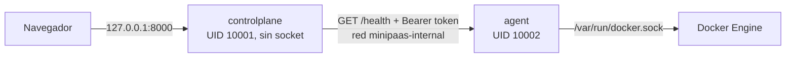

# Informe de cierre — Fase 1: Estructura del proyecto y entorno aislado

> Informe autocontenido para Gemini (memoria académica y presentación).
> Proyecto: **MiniPaaS** — *«Diseño e implementación de una plataforma PaaS ligera para el despliegue
> y gestión de aplicaciones distribuidas»*. Asignatura: GSASD.

---

## A. Identificación

| Campo | Valor |
|---|---|
| Fase | 1 — Estructura del proyecto y entorno aislado |
| Fecha | 2026-11-15 |
| Objetivo | Crear la estructura del código, las herramientas de calidad y pruebas, y un entorno local en contenedores en el que el control plane y el agente se comunican de forma autenticada, respetando desde el principio la separación de privilegios aprobada en la Fase 0. |
| Estado | **Completada y revisada; pendiente de aprobación del equipo.** Tras la primera revisión se corrigieron los permisos del token y la reproducibilidad de las imágenes (apartado B.5). El CI no se ha podido ejecutar en GitHub porque el *push* sigue pendiente (apartado F). |

Qué hay y qué no: existe un **esqueleto funcional** (dos procesos que se comunican y un panel de
estado). **No se puede desplegar ninguna aplicación todavía**; eso empieza en la Fase 3.

---

## B. Trabajo realizado

### B.1 Funcionalidades implementadas y verificadas

| Funcionalidad | Estado |
|---|---|
| Paquete Python `minipaas` con `common`, `controlplane` y `agent` | Implementado y verificado |
| Agente: `GET /health` autenticado con token, comprueba si Docker responde; sin OpenAPI expuesta | Implementado y verificado |
| Control plane: `GET /api/health` (estado propio, del agente y de Docker, sin versiones ni detalles técnicos) | Implementado y verificado |
| Panel «Estado del sistema» (tres indicadores, modo claro/oscuro, adaptable a móvil, sin CDN) | Implementado; verificado por tests y `curl`; **revisión visual pendiente** por el equipo |
| Cabeceras de seguridad HTTP (CSP, `nosniff`, `no-referrer`, `X-Frame-Options`) | Implementado y verificado |
| Token compartido como *secret* de archivo (una copia `600` por componente), longitud mínima, comparación en tiempo constante | Implementado y verificado |
| Imágenes construidas desde `uv.lock` con verificación de hashes | Implementado y verificado |
| Imágenes Docker con usuarios sin privilegios | Implementado y verificado |
| `compose.dev.yaml` con red interna, socket solo en el agente y endurecimiento de contenedores | Implementado y verificado |
| Scripts de preparación y de verificación del aislamiento | Implementado y verificado |
| CI (GitHub Actions: ruff + pytest) | Implementado; **no ejecutado en GitHub** (sin *push*). Los mismos comandos pasan en local |

### B.2 Archivos creados

| Archivo | Propósito |
|---|---|
| `pyproject.toml`, `uv.lock` | Paquete, dependencias (bloqueadas), configuración de ruff y pytest |
| `src/minipaas/common/naming.py` | Prefijo `minipaas-` y etiquetas `minipaas.managed` / `minipaas.component` |
| `src/minipaas/common/secrets.py` | Lectura y validación del token compartido |
| `src/minipaas/agent/{config,docker_runtime,main}.py` | Configuración, acceso a Docker (`ping`) y API del agente |
| `src/minipaas/controlplane/{config,agent_client,main}.py` | Configuración, cliente HTTP del agente y API del control plane |
| `src/minipaas/controlplane/web/{index.html,css/styles.css,js/app.js}` | Panel de estado |
| `tests/unit/*` (4 archivos) | Token, nombres, configuración, errores de Docker |
| `tests/api/*` (2 archivos) | API del agente y del control plane con dobles de prueba |
| `tests/integration/test_docker_runtime.py` | Comprobación contra el Docker local real (solo lectura) |
| `deploy/Dockerfile.controlplane`, `deploy/Dockerfile.agent` | Imágenes `python:3.12-slim` con UID 10001 / 10002 |
| `deploy/compose.dev.yaml`, `deploy/.env.example` | Entorno local `minipaas-dev` |
| `deploy/requirements/{controlplane,agent}.txt` | Dependencias exportadas de `uv.lock` con hashes (las usan los Dockerfiles) |
| `scripts/export_requirements.sh` | Regenera `deploy/requirements/` desde `uv.lock` |
| `scripts/prepare_dev_env.sh`, `scripts/verify_dev_env.sh` | Preparación (tokens, GID) y verificación automática (10 comprobaciones) |
| `.github/workflows/ci.yml` | Integración continua |
| `.dockerignore` | Excluye código no necesario, secretos y documentación de las imágenes |
| `docs/guia-desarrollo.md`, `docs/informes/fase-01.md` | Guía del entorno local e informe |

Modificados: `.gitignore` (ignora `deploy/secrets/` y `deploy/.env`), `README.md`, `CHANGELOG.md`,
`docs/README.md`, `docs/decisiones.md` (ADR-013 a 015), `docs/08-estructura-proyecto.md`,
`docs/registro-pruebas.md`, `docs/bibliografia.md`. Eliminados: ninguno. `formato_preguntas.md`:
sin cambios (hash verificado).

### B.3 Dependencias añadidas

| Dependencia | Versión | Uso | Licencia |
|---|---|---|---|
| FastAPI (y Starlette) | 0.163.1 (1.10.0) | Framework web de ambos procesos | MIT (BSD-3) |
| Uvicorn | 0.54.0 | Servidor ASGI (sin extras, para ser ligero) | BSD-3 |
| HTTPX | 0.28.1 | Cliente HTTP control plane → agente | BSD-3 |
| Docker SDK for Python | 7.2.0 | Solo en la imagen del agente | Apache-2.0 |
| pytest, pytest-cov, ruff | 9.2.0, 7.1.0, 0.17.5 | Solo desarrollo | MIT |

### B.4 Decisiones técnicas nuevas

| ADR | Decisión | Motivo |
|---|---|---|
| 013 | `uv` y `uv.lock` en desarrollo y CI; las imágenes instalan el bloqueo exportado con hashes | Reproducibilidad e integridad sin añadir herramientas a las imágenes |
| 014 | Token como *secret* de archivo, una copia `600` por componente | Las variables de entorno se ven con `docker inspect`; mínimo privilegio sobre el archivo |
| 015 | Python 3.12 en imágenes, CI y entorno local | Probar exactamente lo que se ejecuta |

### B.5 Cambios tras la revisión del equipo (2026-11-15)

| Punto revisado | Problema | Solución adoptada | Verificación |
|---|---|---|---|
| Permisos del token | El archivo tenía `644` porque Compose (sin Swarm) monta el *secret* con el propietario y permisos del host e **ignora** `uid/gid/mode` (comprobado: «not supported outside Swarm mode»). Con `600` y propietario el usuario del host, los UID 10001/10002 no podían leerlo | Una copia del mismo token por componente: `controlplane_token` (`600`, UID 10001) y `agent_token` (`600`, UID 10002), directorio `700`. El propietario se asigna con un contenedor efímero sin red (sin `sudo`, sin privilegios nuevos) | 3 comprobaciones nuevas en `verify_dev_env.sh`, todas OK; el usuario del host ya no puede leer el token |
| Reproducibilidad de las imágenes | `pip install .` resolvía versiones al construir y descargaba `hatchling` sin fijar | `uv export` con hashes → `deploy/requirements/*.txt`; `pip --require-hashes`; código en `PYTHONPATH`; el CI comprueba la sincronización con `uv.lock` | Versiones dentro de las imágenes iguales al bloqueo; tamaño 203/208 MB (antes 204/209) |

Decisiones menores (documentadas en el código y en la guía): etiqueta `minipaas.component` para los
contenedores de la plataforma (que **no** llevan `minipaas.managed`, para que el agente nunca pueda
pararse a sí mismo ni al control plane); el control plane responde siempre 200 en `/api/health` y el
panel interpreta el campo `status`; factorías `create_app(...)` con dependencias inyectadas para poder
probar con dobles.

---

## C. Justificación académica y técnica

### C.1 Qué problema resuelve cada pieza

| Pieza | Problema que resuelve |
|---|---|
| Red `minipaas-internal` con `internal: true` | El agente (el componente con más privilegios) no es alcanzable desde fuera ni puede salir a Internet: reduce su superficie de ataque. Concepto de **segmentación de red**. |
| Socket de Docker solo en el agente | Aplica la separación de privilegios aprobada (ADR-002): el componente expuesto a la red no controla Docker. |
| `group_add` con el GID del socket | Permite al agente usar Docker **sin ser root** dentro del contenedor. |
| `read_only`, `tmpfs`, `cap_drop: ALL`, `no-new-privileges` | **Endurecimiento** de los contenedores: un atacante no puede modificar el código, no tiene *capabilities* de Linux ni puede escalar con binarios setuid. |
| Token con `hmac.compare_digest` | **Autenticación** entre servicios; la comparación en tiempo constante evita ataques de temporización. |
| Control plane publicado solo en `127.0.0.1` | Durante el desarrollo, el panel no es accesible desde la red local. |
| Cliente del agente que nunca lanza excepciones | El panel siempre puede informar del estado, aunque el agente esté caído (**tolerancia a fallos** y degradación controlada). |
| `scripts/verify_dev_env.sh` | Convierte las propiedades de seguridad en comprobaciones **automáticas y repetibles**, no en afirmaciones. |

### C.2 Alternativas consideradas

- Gestión de dependencias: `pip` + `requirements.txt`, Poetry y uv (ADR-013).
- Entrega del token: variable de entorno o *secret* de archivo (ADR-014).
- Acceso no root al socket: ejecutar el agente como root (descartado) o añadir el grupo del socket
  (elegido).
- Pruebas del control plane: levantar el agente real o simular el agente con `httpx.MockTransport`.
  Se eligió simularlo en los tests de API (rápidos, sin Docker) y comprobar la integración real con
  el script de verificación.

### C.3 Ventajas e inconvenientes

Ventajas: las propiedades de aislamiento existen desde el primer día y se verifican
automáticamente; consumo medido muy bajo (≈ 83 MiB en total, medida puntual); los tests no
necesitan Docker salvo los de integración.

Inconvenientes y limitaciones:

- Pertenecer al grupo `docker` sigue equivaliendo a root sobre el host: el agente **no es root en su
  contenedor**, pero el riesgo del socket permanece (riesgo residual reconocido en la Fase 0).
- El script de preparación usa un contenedor root efímero para asignar el propietario de los tokens;
  es legítimo porque el desarrollador ya tiene acceso a Docker, pero conviene explicarlo.
- Tras cambiar dependencias hay que exportar el bloqueo (`scripts/export_requirements.sh`); el CI lo
  detecta si se olvida.
- Si el agente no responde, `/api/health` tarda 3 s (el timeout) en contestar.

### C.4 Conceptos de GSASD aplicados

Servicios distribuidos que se comunican por red (control plane ↔ agente por HTTP), descubrimiento
por DNS interno de Docker (`http://agent:8001`), redes aisladas, autenticación entre servicios,
mínimo privilegio, aislamiento con *namespaces* y *capabilities*, comprobaciones de salud
(*healthcheck*) y degradación controlada ante fallos.

---

## D. Pruebas y resultados

Resultados **reales**, ejecutados en local el 2026-11-15 (detalle en `docs/registro-pruebas.md`,
entradas 1.1–1.25; las 1.13–1.25 corresponden a la revisión):

| Prueba | Comando | Resultado |
|---|---|---|
| Estilo y análisis estático | `uv run ruff check .`; `uv run ruff format --check .` | Sin errores; 35 archivos formateados |
| Unitarias y de API | `uv run pytest -m "not integration" --cov=minipaas` | **32 passed**, cobertura **96 %** |
| Integración con Docker | `uv run pytest -m integration` | **1 passed** |
| Aislamiento del entorno (1.ª versión) | `bash scripts/verify_dev_env.sh` | **7/7 OK** |
| Aislamiento tras la revisión (7 + 3 de permisos del secret) | `bash scripts/verify_dev_env.sh` | **10/10 OK** |
| Repetición tras la revisión: ruff, unitarios/API, integración | mismos comandos | Sin errores; **32 passed** (96 %); **1 passed** |
| Imágenes desde el bloqueo | `build --no-cache`; `importlib.metadata` en los contenedores | Versiones idénticas a `uv.lock`; sin `hatchling` ni SDK de Docker en el control plane |
| Token incorrecto | Petición al agente desde el control plane | 401 |
| Salida a Internet del agente | Conexión a 1.1.1.1:443 desde el agente | Bloqueada |
| Cabeceras del panel | `curl -sI http://127.0.0.1:8000/` | Presentes |
| Agente caído | `stop agent` + `curl /api/health` | `degraded` en 3,0 s, error registrado |
| Consumo | `docker stats --no-stream` | 38,4 MiB + 44,4 MiB (orientativo) |
| Limpieza | `down` + listados | 0 contenedores y 0 redes residuales; nada ajeno tocado |

Errores encontrados y corregidos en la revisión del código:

1. Captura incompleta de errores de Docker en `ping()` (habría dado un diagnóstico erróneo si Docker
   se cae con el agente funcionando). Corregido y con test.
2. El cliente HTTP del agente no se cerraba al apagar. Corregido y con test.
3. Un parámetro sin uso y un nombre de test duplicado. Corregidos.

Pruebas pendientes: ejecución del CI en GitHub; revisión visual del panel; rechazo del agente ante
peticiones procedentes de contenedores ajenos (no aplica aún: la red interna solo contiene los dos
componentes).

---

## E. Arquitectura y código

Flujo de `/api/health`:

1. El navegador carga el panel (`/`) y su JavaScript pide `/api/health`.
2. El control plane llama a `AgentClient.health()`, que hace `GET http://agent:8001/health` con la
   cabecera `Authorization: Bearer <token>` y un timeout de 3 s.
3. El agente comprueba el token (`hmac.compare_digest`) y llama a `DockerRuntime.ping()`, que pide la
   versión a Docker por el socket.
4. El control plane reduce la respuesta a tres booleanos (sin versiones) y el panel pinta los
   indicadores.

Relaciones entre módulos: `common` no depende de nadie; `agent` y `controlplane` dependen de
`common`, pero no entre sí (solo se comunican por HTTP). Solo `agent/docker_runtime.py` importa el
SDK de Docker.

---

## F. Git

| Commit | Rama | Mensaje |
|---|---|---|
| `8927b50` | `fase-01-estructura` | `feat: estructura del paquete con control plane y agente mínimos` |
| `23791cb` | `fase-01-estructura` | `feat: entorno de desarrollo aislado con Docker Compose` |
| `c277f12` | `fase-01-estructura` | `test: integración continua con ruff y pytest en GitHub Actions` |
| `b355ad4` | `fase-01-estructura` | `docs: guía de desarrollo, ADR-013 a 015 e informe de la Fase 1` |
| `9d5145d` | `fase-01-estructura` | `security: token con permisos 600 por componente y directorio 700` (revisión) |
| `15738cc` | `fase-01-estructura` | `feat: imágenes reproducibles a partir de uv.lock con hashes` (revisión) |
| `12d457f` | `fase-01-estructura` | `docs: revisión de la Fase 1 (permisos del token y reproducibilidad)` |
| *(siguiente)* | `fase-01-estructura` | `docs: registra los commits de la revisión en el informe de la Fase 1` (contiene esta tabla) |

Otras operaciones: la rama `fase-00-analisis` se fusionó en `main` por *fast-forward* (hasta
`e7a93fe`) al autorizarse el inicio de la Fase 1; `fase-01-estructura` parte de ese punto.

Historia: lineal, sin reescrituras ni *push* forzado. Árbol de trabajo limpio tras el último commit.

*Push*: **pendiente**. Último intento real: al cerrar la primera versión de la fase (`could not read
Username for 'https://github.com': terminal prompts disabled`). En la revisión **no se ha vuelto a
intentar**; se comprobó sin hacer peticiones que siguen sin existir credenciales: sin
`credential.helper`, sin CLI `gh`, sin `GH_TOKEN`/`GITHUB_TOKEN` y sin `~/.git-credentials`.

Para ejecutar el CI en GitHub falta:

1. Una credencial con permiso de escritura en `javialbala/server-monitoring-service`: instalar y
   autenticar `gh` (`gh auth login`), configurar un *token* de acceso personal con un *credential
   helper*, o autorizar el uso del remoto por SSH (hay una clave en el equipo, no comprobada).
2. Subir `main`, `fase-00-analisis` y `fase-01-estructura` (`git push -u origin <rama>`; sin
   `--force`). El *workflow* se ejecuta en cada *push* y *pull request*.
3. Que GitHub Actions esté habilitado en el repositorio (opción por defecto).

---

## G. Pendientes

- **Push y CI**: subir las ramas y comprobar que el *workflow* pasa en GitHub.
- **Revisión visual del panel** por el equipo (<http://127.0.0.1:8000> con el entorno levantado).
- Fijar la imagen base `python:3.12-slim` por *digest* (ADR-013): antes del despliegue final.
- Aplicar en el servidor el mismo esquema de tokens `600` por componente (ADR-014): Fase 13.
- Timeout de 3 s en `/api/health` con el agente caído: aceptable ahora; se puede reducir o cachear
  cuando el panel tenga más vistas.
- Aviso de deprecación de Starlette sobre `TestClient` con `httpx`: no afecta; vigilar al actualizar
  dependencias.
- Cuestiones abiertas de la Fase 0: licencia y nombre del repositorio.

Siguiente fase propuesta (Fase 2): base de datos SQLite con esquema y migraciones, modelo de
aplicaciones (sin Docker), autenticación del administrador único con sesiones y CSRF, auditoría y
primeras vistas del panel (inicio de sesión y lista de aplicaciones).

---

## H. Instrucciones para Gemini

### Qué añadir a la memoria

- Capítulo de **desarrollo**, sección «Fase 1: entorno aislado»: cómo se materializa la separación de
  privilegios en Docker Compose (tabla de C.1) y cómo se verifica con un script.
- En **seguridad**: endurecimiento de contenedores (`read_only`, `cap_drop`, `no-new-privileges`,
  usuarios no root), red interna sin salida, token como *secret*, comparación en tiempo constante.
- En **tecnologías**: FastAPI, Uvicorn, HTTPX, SDK de Docker, uv, ruff, pytest, con sus licencias.
- En **pruebas**: la pirámide de pruebas aplicada (unitarias / API con dobles / integración / script
  de verificación) con los resultados de D.

### Decisiones que debe registrar

ADR-013 (incluida su revisión: imágenes desde el bloqueo con hashes), ADR-014 (incluida la
limitación de Compose fuera de Swarm y la solución de una copia `600` por componente) y ADR-015.

### Diagramas

- Actualizar el diagrama de componentes con la topología real de la Fase 1 (diagrama del apartado E):
  dos redes, puertos, UIDs y quién tiene el socket.
- Diagrama de secuencia de `/api/health` (pasos 1–4 del apartado E).

### Presentación

- Diapositiva «Seguridad desde el primer día»: las 10 comprobaciones de `verify_dev_env.sh` en verde (incluidos los permisos `600` del token).
- Captura del panel «Estado del sistema» (cuando el equipo la haga).

### Qué NO debe considerar definitivo

- El consumo de 83 MiB es una **medida puntual** del esqueleto; no verifica el objetivo de diseño de
  < 250 MB (RNF-07), que se medirá en la Fase 12 con la plataforma completa.
- El CI aún no se ha ejecutado en GitHub.
- La configuración de Compose es de **desarrollo** (panel en `127.0.0.1`, imagen base sin fijar por
  *digest*); la de producción se definirá en la Fase 13.
- No hay todavía despliegue de aplicaciones, base de datos ni autenticación de usuarios.
