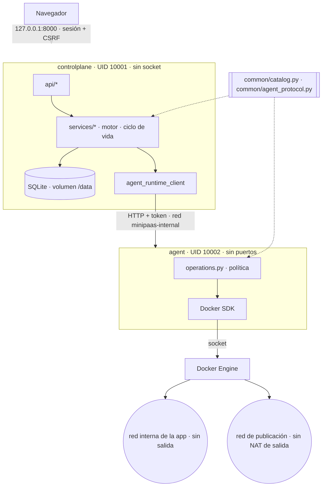
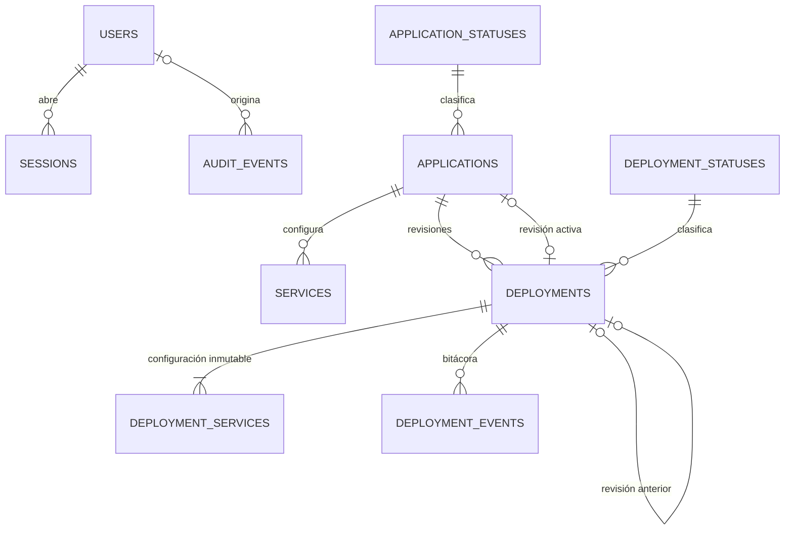
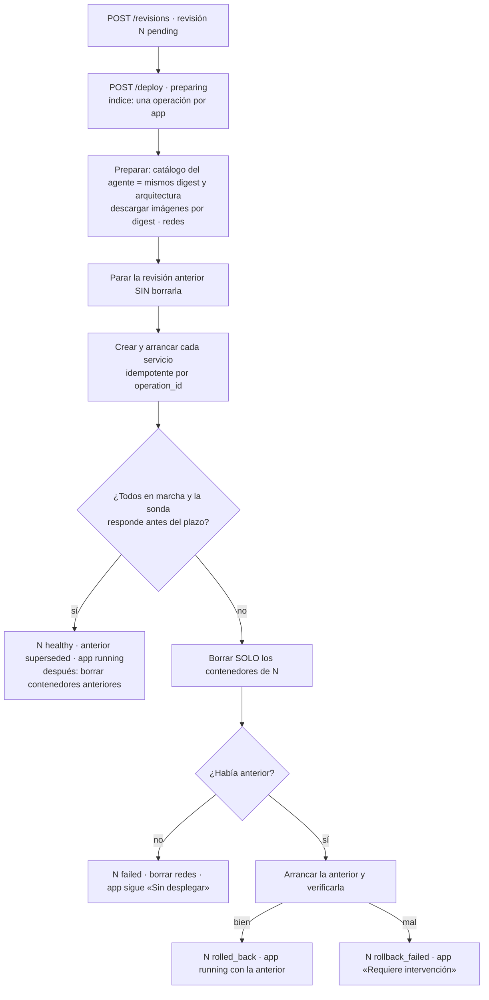

# Informe de cierre — Fase 3: Motor de despliegue y gestión de servicios Docker

> Informe autocontenido para Gemini (memoria académica y presentación).
> Proyecto: **MiniPaaS** — *«Diseño e implementación de una plataforma PaaS ligera para el despliegue
> y gestión de aplicaciones distribuidas»*. Asignatura: GSASD. Fecha: **2026-11-15**.
> Estado: **terminada y verificada con Docker real; pendiente de aprobación del equipo.**

Leyenda: **Diseñado** (decidido y documentado) · **Implementado** (código escrito) · **Verificado**
(prueba ejecutada con resultado real) · **Pendiente** (no hecho).

---

## 1. Objetivo y alcance

Permitir desde el panel administrar aplicaciones con **varios servicios** que se ejecutan en Docker:
elegir servicios de un **catálogo cerrado** de imágenes, configurarlos, crear **revisiones
inmutables**, desplegarlas, consultar su **estado real**, detenerlas y arrancarlas, ver el
**historial** y **recuperar automáticamente** la última versión que funcionaba si un despliegue falla.
El usuario nunca usa Docker directamente: *MiniPaaS gestiona aplicaciones; Docker es el motor interno*.

Límites respetados: el control plane sigue **sin acceso al socket**; el agente es el único componente
que habla con Docker y solo mediante operaciones cerradas; desarrollo y pruebas solo en local; sin
*push*; sin volúmenes de aplicación ni servicios con estado.

## 2. Funcionalidades implementadas

| Funcionalidad | Estado |
|---|---|
| Catálogo cerrado (2 entradas + 2 de prueba), imágenes fijadas por digest, validado en control plane y agente | Implementado y verificado |
| Servicios por aplicación (alta, edición, borrado protegido), variables solo del catálogo, puertos en rango con asignación automática y sin conflictos | Implementado y verificado |
| Revisiones numeradas e inmutables (*trigger*), deduplicación por `request_id` | Implementado y verificado |
| Despliegue `recreate` en segundo plano con verificación de salud por sonda | Implementado y verificado (Docker real) |
| Rollback automático (fallo de arranque y de salud) y primera versión fallida sin restos | Implementado y verificado (Docker real) |
| Estado real de cada servicio consultado al agente, con URL de acceso | Implementado y verificado |
| Detener, arrancar, recuperar; borrar aplicación retirando sus recursos Docker | Implementado y verificado (Docker real) |
| Dos redes por aplicación (interna sin salida + publicación sin NAT de salida) | Implementado y verificado |
| Contenedores endurecidos (no root, solo lectura, sin capacidades, `no-new-privileges`, límites de memoria/CPU/procesos, sin montajes ni dispositivos) | Implementado y verificado (`docker inspect`) |
| Propiedad por etiquetas e instancia; recursos ajenos intocables | Implementado y verificado |
| Exclusión mutua por aplicación (índice SQLite + candado) | Implementado y verificado (hilos) |
| Operaciones interrumpidas por reinicio del control plane: `interrupted` + recuperación automática | Implementado y verificado (Docker real) |
| Auditoría del ciclo completo sin valores de variables | Implementado y verificado |
| Panel: servicios, despliegue con progreso, estado real, historial con bitácora, acciones | Implementado y verificado en navegador |

## 3. Funcionalidades excluidas

| Excluido | Motivo / fase |
|---|---|
| Volúmenes persistentes y servicios con estado (bases de datos) | Fase 6; sin volúmenes, una BD perdería sus datos en cada despliegue |
| Gestión de secretos | No se incluye ninguna imagen que necesite credenciales |
| Proxy inverso, nombres de dominio, *blue-green* | Fase 7 (opcional); `recreate` implica un corte breve |
| Rollback manual a una revisión antigua, plantillas de varios servicios | Fase 4 |
| Logs, métricas, gráficas | Fase 8 |
| Políticas de reinicio y cuota global de recursos | Fase 9 (hoy `restart: no`) |
| Escaneo de vulnerabilidades y firma de imágenes | Fuera del alcance (riesgo documentado) |

## 4. Arquitectura final



Principios: el contrato compartido (catálogo, nombres, protocolo) lo usan los dos procesos, pero cada
uno valida por su cuenta; la orquestación (estados, rollback, auditoría) vive en el control plane, que
tiene la base de datos; el agente es pequeño y solo ejecuta operaciones cerradas.

## 5. Modelo de servicios y despliegues

- **Servicio** (`services`): configuración deseada dentro de una aplicación: nombre (único en la app,
  dirección interna), entrada del catálogo, puerto interno, publicación y puerto de acceso, variables
  permitidas, memoria y CPU. Nombre y tipo inmutables. No es un contenedor (ADR-025).
- **Revisión / despliegue** (`deployments`): una por cada despliegue solicitado, con número, `operation_id`
  (UUID que viaja como etiqueta de los contenedores), `request_id` (deduplicación), estado, revisión
  anterior, error resumido y fechas. Su configuración se copia en `deployment_services` (con la imagen
  y el digest) y no se puede modificar (ADR-028).
- **Bitácora** (`deployment_events`): pasos de cada operación (`prepare`, `deploy`, `verify`,
  `cleanup`, `result`) con resultado y mensaje.
- **Tres estados**: lógico de la aplicación (`draft`, `running`, `stopped`, `attention`), del
  despliegue (12 estados) y real de los contenedores (siempre preguntado al agente).

## 6. Diagrama entidad-relación (tras la migración 0002)



Migración no destructiva: añade estados a `application_statuses`, crea `deployment_statuses`,
`services`, `deployments`, `deployment_services` (con *trigger* de inmutabilidad),
`deployment_events`, el índice parcial `one_operation_per_app` y la columna
`applications.active_deployment_id`. Verificado sobre una base de datos con datos de la Fase 2 y sobre
la base de datos de desarrollo real (versión 2).

## 7. Flujo de despliegue



## 8. Catálogo de imágenes

| Id | Imagen | Versión | Digest del índice (SHA-256) | Arquitecturas | Puerto | Usuario | Salud | Memoria / CPU (defecto, rango) | Licencia |
|---|---|---|---|---|---|---|---|---|---|
| `nginx-static` | `nginxinc/nginx-unprivileged` | 1.29.8-alpine | `0c79d56aee561a1d81c63f00eee5fb5fe29279560cdc55e91425133104c7fbe6` | amd64, arm64, arm/v7, arm/v6, 386, ppc64le, riscv64, s390x | 8080 | 101:101 | `GET /` | 64 MiB (32–256) · 0,5 (0,1–1) | Dockerfiles Apache-2.0; NGINX BSD-2-Clause; Alpine: licencias de sus paquetes |
| `whoami` | `traefik/whoami` | v1.11.0 | `200689790a0a0ea48ca45992e0450bc26ccab5307375b41c84dfc4f2475937ab` | amd64, arm64, arm/v7 | 80 | 65534:65534 (forzado: la imagen no define usuario) | `GET /health` | 32 MiB (16–128) · 0,25 (0,1–0,5) | Apache-2.0 |
| `test-crash` (solo pruebas) | nginx (mismo digest) | — | — | — | 8080 | 101:101 | — | — | — |
| `test-unhealthy` (solo pruebas) | nginx (mismo digest) | — | — | — | 8080 | 101:101 | ruta inexistente (404) | — | — |

- Digest comprobados con `docker manifest inspect` y `docker pull` el 2026-11-15.
- Variables permitidas: solo `WHOAMI_NAME` en `whoami` (patrón `[A-Za-z0-9 ._-]{1,40}`). NGINX necesita
  un `tmpfs` de 32 MiB en `/tmp` (definido en el catálogo, no por el usuario).
- Las entradas de prueba solo existen con `MINIPAAS_ENABLE_TEST_CATALOG=true` (E2E y tests).
- Limitaciones: NGINX solo muestra su página de bienvenida (no hay forma de subir contenido hasta la
  Fase 6); whoami es solo de demostración. Verificado solo en amd64.

## 9. Comunicación control plane–agente

- HTTP sobre la red Docker interna, token compartido (Fase 1), modelos Pydantic estrictos de
  `common/agent_protocol.py` (campos desconocidos → 422), errores `{"detail", "code"}` (400, 401, 404,
  409, 422, 502, 503).
- Cliente síncrono en el control plane con **plazo por operación** (descarga 300 s, crear/arrancar/
  parar/borrar 30 s, sonda 20 s, resto 10 s) y errores tipados.
- Idempotencia: `request_id` en revisiones; transición `pending → preparing` condicional; nombre de
  contenedor determinista + etiqueta `operation` en el agente (misma operación → mismo contenedor,
  otra → 409).
- Un *timeout* no se interpreta como «no se hizo»: la limpieza se hace por `operation_id`.

## 10. Operaciones permitidas del agente

`GET /health`, `GET /catalog`, `POST /images/ensure`, `POST|DELETE /apps/{slug}/networks`,
`GET|POST /apps/{slug}/containers`, `POST …/containers/{name}/start|stop|probe`,
`DELETE …/containers/{name}`, `POST /apps/{slug}/operations/{op}/cleanup`, `DELETE /apps/{slug}`.
**No existen**: `exec`, `build`, montajes, dispositivos, `cap_add`, `privileged`, `network_mode`,
imágenes/comandos/entrypoints/argumentos del cliente ni un endpoint genérico. Toda operación sobre un
recurso comprueba `minipaas.managed=true`, la instancia, la aplicación y el rol (no solo el nombre).

## 11. Seguridad y aislamiento

| Medida | Verificación |
|---|---|
| Control plane sin socket; agente sin puertos, en red sin salida | `verify_dev_env.sh` 12/12 |
| Solo imágenes del catálogo por digest; `RepoDigests` comprobado antes de crear | Tests del agente |
| Usuario no root, raíz de solo lectura, `cap_drop ALL`, `no-new-privileges`, `privileged=false`, límites de memoria (sin swap), CPU y procesos, sin montajes ni dispositivos | `docker inspect` en integración y E2E |
| Red interna por aplicación sin Internet; otra app no alcanza ni por nombre ni por IP | Integración y E2E |
| Publicación solo en el rango y en la dirección que fija el agente (`127.0.0.1`) | Tests y E2E |
| Recursos ajenos y de otra instancia intocables | Integración (contenedor ajeno sigue en marcha) y E2E (ajenos sin cambios) |
| Sin valores de variables en logs ni auditoría | Tests con `caplog` y recorrido de la tabla de auditoría |

## 12. Estrategia de despliegue

`recreate` (ADR-011/033): se para la revisión activa sin borrarla, se crean y arrancan los nuevos, se
verifica la salud y solo entonces se borran los anteriores. Implica un **corte breve** en cada
despliegue (sin proxy no hay *blue-green*). Salud = contenedor en marcha, sin haberse detenido, y sonda
HTTP correcta antes del plazo (45 s, reintentos cada 2 s; 20 y 12 s en las entradas de prueba).

## 13. Gestión de errores y rollback

| Fallo | Detección | Resultado verificado |
|---|---|---|
| Descarga, creación o catálogo desconocido | Error del agente | Rollback / `failed` (agente falso) |
| Arranque (`test-crash`, código 1) | Estado `exited` | `rolled_back`, r1 activa respondiendo (Docker real) |
| Salud (`test-unhealthy`, 404) | Sonda hasta el plazo | `rolled_back` (Docker real) |
| Primera versión fallida | Igual | `failed`, sin contenedores ni redes (Docker real) |
| Rollback que también falla | Agente falso | `rollback_failed`, app «Requiere intervención» |
| Agente perdido en pleno despliegue o durante el rollback | Agente falso | `failed`/`rollback_failed` + `attention`; «Recuperar» al volver |
| *Timeout* tras ejecutar | Agente falso | Sin contenedores huérfanos de la operación |

El rollback recupera la **versión de la aplicación**, no datos (ADR-011); no hay servicios con estado.

## 14. Recuperación de operaciones interrumpidas

- **Al apagar** el control plane: el motor recibe la señal `stopping`, abandona la operación **sin
  juzgarla** (sin marcarla fallida ni intentar rollback) y solo después se cierran los clientes.
- **Al arrancar**: revisiones en `preparing`/`deploying`/`rolling_back` → `interrupted`, aplicación →
  «Requiere intervención», y recuperación automática en segundo plano.
- **Recuperar** (automático o botón): pregunta al agente los contenedores reales; borra solo los de
  operaciones **conocidas** no activas; los de operaciones **desconocidas** no se tocan y se informa;
  vuelve a poner en marcha la revisión activa (o la deja detenida). Si el agente no responde, queda en
  «Requiere intervención».
- Ninguna operación se reanuda en el punto exacto (ADR-034). Verificado con Docker real: reinicio del
  contenedor del control plane durante un despliegue → `interrupted`, aplicación `running` con r1, sin
  contenedores de la operación cortada.

## 15. Interfaz implementada

La vista de detalle de aplicación es el centro de gestión, con el diseño aprobado:

- **Cabecera**: estado lógico, revisión activa y acciones según el estado (Desplegar, Detener,
  Arrancar, Recuperar con explicación, Editar, Eliminar con aviso de retirada de servicios).
- **Servicios**: tipo, acceso («Publicado en el puerto 20000» / «Solo interno»), recursos, variables;
  formulario que solo ofrece lo que permite el catálogo (tipo con descripción, imagen y licencia;
  nombre; puerto; publicación; variables declaradas; memoria y CPU con su rango); servicios
  protegidos.
- **Estado real**: estado de cada contenedor, código de salida, enlace «Abrir»; avisos si el agente no
  responde o hay contenedores desconocidos.
- **Historial**: revisiones con estado, «Activa», servicios, motivo del fallo, «Falló y se recuperó la
  revisión N» y bitácora desplegable.
- **Despliegue**: panel de progreso con consulta cada 2 s solo mientras hay operación; 0 peticiones en
  reposo (medido); avisos de éxito, recuperación o error.

## 16. Dependencias nuevas

Ninguna dependencia de Python nueva. Imágenes de contenedor nuevas: las dos del catálogo (§8). Para la
revisión visual se usó Playwright como herramienta temporal (`uvx`), **no** como dependencia del
proyecto.

## 17. ADR creadas o modificadas

| ADR | Decisión |
|---|---|
| 025 | Modelo de servicios separado de los contenedores |
| 026 | Catálogo cerrado en el backend, validado por los dos procesos |
| 027 | Imágenes por digest del índice; verificación de `RepoDigests` |
| 028 | Revisiones numeradas e inmutables; tres estados distintos |
| 029 | Protocolo y operaciones cerradas del agente; idempotencia |
| 030 | Salud mediante sonda efímera en la red interna |
| 031 | Dos redes por aplicación (hallazgo: no se publican puertos desde redes `internal`) |
| 032 | Asignación de puertos en el rango y dirección fijada por el agente |
| 033 | `recreate` con rollback automático a contenedores conservados |
| 034 | Exclusión mutua y recuperación de operaciones interrumpidas |
| 035 | Instancias de MiniPaaS sobre el mismo Docker |

Cada una con contexto, problema, alternativas, decisión, justificación y consecuencias
(`docs/decisiones.md`).

## 18. Archivos creados, modificados y eliminados

Resumen (`ac9db31..12696ca`, antes de este informe): **38 creados, 21 modificados, 0 eliminados**
(+8 050 / −133 líneas).

| Tipo | Archivos |
|---|---|
| Contrato | `src/minipaas/common/{catalog,agent_protocol}.py` (nuevos), `naming.py` (ampliado) |
| Agente | `agent/{operations,errors}.py` (nuevos); `agent/{config,docker_runtime,main}.py` |
| Control plane | `agent_runtime_client.py`; `api/{catalog,services,deployments}.py`; `repositories/{services,deployments}.py`; `services/{app_services,deployments,deploy_engine,app_lifecycle,errors}.py`; `db/migrations/0002_services_deployments.sql` (nuevos); `config.py`, `main.py`, `schemas.py`, `api/applications.py`, `repositories/applications.py`, `services/audit.py` |
| Panel | `web/js/tones.js`, `web/js/views/{app-header,app-services,service-form,app-runtime,app-deployments,app-deploy}.js` (nuevos); `web/js/{ui.js,views/app-detail.js,views/apps.js}`, `web/css/styles.css` |
| Pruebas | `tests/agent_fakes.py`, `tests/fakes/fake_agent.py`, `tests/integration/test_agent_docker.py`, `tests/api/test_{catalog,services,deployments,deploy_failures,lifecycle}_api.py`, `tests/unit/test_{agent_config,agent_operations,cp_config,cp_migration_0002,cp_runtime_client}.py` (nuevos); `tests/conftest.py`, `tests/api/test_{agent,applications,controlplane}_api.py`, `tests/unit/test_{database,manage}.py` |
| Scripts y entorno | `scripts/e2e_phase3.{sh,py}` (nuevos); `deploy/compose.dev.yaml` (3 variables) |
| Documentación | `docs/{03-arquitectura,04-seguridad,05-estrategia-pruebas,06-roadmap,08-estructura-proyecto,api,bibliografia,decisiones,guia-desarrollo,registro-pruebas}.md`, `README.md`, `CHANGELOG.md`; `docs/informes/fase-03.md` (este) |

Sin cambios: `deploy/secrets/`, `deploy/Dockerfile.*`, `formato_preguntas.md` (hash verificado).

## 19. Pruebas ejecutadas y resultados reales

| Prueba | Comando | Resultado |
|---|---|---|
| Estilo | `uv run ruff check .`; `uv run ruff format --check .` | Sin errores; 108 archivos |
| Suite completa | `uv run pytest --cov=minipaas` | **437 passed**; cobertura **98 %** |
| Integración Docker | `uv run pytest -m integration` | **8 passed**; sin restos `itest` |
| Aislamiento `dev` | `bash scripts/verify_dev_env.sh` | **12/12 OK** |
| E2E | `bash scripts/e2e_phase3.sh` | **23/23 OK**; sin restos |
| Panel | Chromium + Playwright (temporal) | Flujo completo correcto; 0 errores JS; 0 peticiones en reposo |

Distribución: 102 tests de la API del agente, 41 de servicios, 22 de ciclo de vida, 13 de despliegues,
13 de fallos del motor, 8 de la migración 0002, 7 de integración del agente, más los de fases
anteriores. Exploratorias previas al diseño: entradas 3.1–3.9 de `docs/registro-pruebas.md`.

## 20. Resultados E2E con Docker

23 comprobaciones (detalle en `registro-pruebas.md`, entrada 3.17): login; alta; dos servicios
(publicado con puerto 20000 asignado automáticamente + interno); variable no autorizada → 422;
despliegue r1 `healthy`; ambos en marcha; acceso desde el host con la variable aplicada; el interno no
se publica; comunicación por nombre; sin Internet; contenedores endurecidos; aislamiento entre
aplicaciones; detener; arrancar; r2 con fallo de arranque → `rolled_back` y r1 respondiendo; r3 con
fallo de salud → `rolled_back`; primera versión fallida → `failed` sin restos; historial; bitácora;
reinicio del control plane → `interrupted` y recuperada; borrado de aplicaciones retira contenedores y
redes; contenedores ajenos sin cambios.

## 21. Errores encontrados y soluciones

| Error | Detección | Solución |
|---|---|---|
| Docker no publica puertos desde redes `internal` | Prueba exploratoria 3.6 | Red de publicación sin NAT de salida (ADR-031) |
| Apagar el control plane en pleno despliegue lo marcaba `rollback_failed` | E2E 3.16 (22/23) | Señal `stopping`, abandono sin juicio, esperas interrumpibles, cierre ordenado; test nuevo; E2E 23/23 |
| El panel validaba el patrón de variables sin anclar | Revisión del informe del subagente | Patrón anclado como en el servidor |
| Bloqueo de peticiones HTTP mientras el motor tenía el candado | Test del subagente | Detener/arrancar/recuperar/borrar responden 409 en vez de esperar |
| `stop_timeout` no es válido en `containers.create` de docker-py | Subagente del agente | Plazo en `container.stop(timeout=10)` |
| Script E2E con nombre de servicio inválido | 1.ª ejecución | Corregido el script (la API lo rechazaba correctamente) |

## 22. Riesgos residuales

- Los servicios **publicados** pueden conectar con procesos del host que escuchan en todas las
  interfaces (comportamiento estándar de Docker; mitigación con cortafuegos en Fases 11/13).
- Vulnerabilidades de las imágenes del catálogo: el digest garantiza integridad, no seguridad; sin
  escaneo ni firmas.
- `restart: no`: tras reiniciar el servidor, las aplicaciones quedan paradas (Fase 9).
- Corte breve en cada despliegue (`recreate`).
- El agente sigue siendo el componente crítico (acceso al socket).
- La recuperación no reanuda operaciones: vuelve a la última revisión buena.
- Verificado solo en amd64; reinicio del **agente** a mitad de despliegue verificado solo con el
  agente falso.

## 23. Funcionalidades pendientes

Rollback manual a una revisión antigua y plantillas (Fase 4); volúmenes y servicios con estado
(Fase 6); proxy inverso y cortafuegos de la red de publicación (Fase 7); logs y métricas (Fase 8);
políticas de reinicio y cuota global (Fase 9); vista de auditoría en el panel; CI en GitHub de esta
rama.

## 24. Commits realizados

Rama `fase-03-motor-despliegue`, creada desde `main` tras integrar por *fast-forward* la Fase 2
aprobada (`ac9db31`).

| Commit | Mensaje |
|---|---|
| `b184ebe` | `feat: contrato compartido de la Fase 3 (catálogo, nombres y protocolo del agente)` |
| `ad3e32b` | `feat: agente runtime con operaciones cerradas sobre Docker` |
| `a6f8c6a` | `feat: servicios, revisiones y motor de despliegue con rollback` (incluye la corrección del apagado) |
| `fddb2af` | `feat: panel de servicios, despliegues, estado real e historial` |
| `c85181c` | `test: prueba extremo a extremo de la Fase 3 con Docker real` |
| `12696ca` | `docs: Fase 3 (arquitectura, API, seguridad, pruebas, guía, hoja de ruta y ADR-025 a 035)` |
| *(siguiente)* | `docs: informe de cierre de la Fase 3` (contiene este informe) |

## 25. Estado real de Git

- `main` local = `ac9db31` (Fase 2). Rama actual `fase-03-motor-despliegue`, árbol limpio tras el
  último commit, historia lineal, sin reescrituras.
- **Sin *push*** (lo gestiona el equipo). El remoto contenía `fase-01-estructura` en la última
  consulta (`git fetch` al empezar la fase).
- Docker local: entorno `minipaas-dev` en marcha con su base de datos migrada a la versión 2; sin
  restos de `itest`, `e2e` ni `ui`; contenedores ajenos intactos.

## 26. Instrucciones de ejecución y verificación

```bash
uv sync --all-extras
uv run ruff check . && uv run ruff format --check .
uv run pytest                         # 437 tests (incluye 8 con Docker real)
bash scripts/verify_dev_env.sh        # 12 comprobaciones; deja el entorno levantado
# Panel: http://127.0.0.1:8000 → aplicación → «Añadir servicio» → «Desplegar» → «Abrir»
bash scripts/e2e_phase3.sh            # 23 comprobaciones con Docker real (~4 min, proyecto aparte)
```

Para probar fallos desde el panel: levantar el entorno con `MINIPAAS_ENABLE_TEST_CATALOG=true`
(aparecen «[Prueba] Fallo al arrancar» y «[Prueba] Arranca pero no está disponible»).

## 27. Directrices para Gemini

### Qué incorporar a la memoria

- Cómo MiniPaaS convierte **aplicaciones** en contenedores: modelo de servicios y revisiones, y la
  distinción entre estado lógico, estado del despliegue y estado real (concepto de *desired state* de
  las PaaS y Kubernetes, en versión simplificada).
- **Catálogo cerrado por digest**: integridad de la cadena de suministro, comparación con los
  *marketplaces*/*buildpacks* de Cloud Foundry y OpenShift.
- **Separación de privilegios** aplicada: el agente construye la configuración; operaciones cerradas;
  propiedad por etiquetas.
- **Redes**: hallazgo de que Docker no publica puertos desde redes `internal` y solución con dos redes
  (aislamiento, DNS interno, NAT/masquerade); riesgo residual.
- **Tolerancia a fallos**: `recreate`, comprobación de salud por sonda, rollback, idempotencia,
  exclusión mutua en la base de datos, recuperación tras reinicio (y el fallo real encontrado en el
  E2E y su corrección: buen ejemplo de por qué probar con contenedores reales).

### Qué diagramas actualizar

1. Topología en ejecución con las dos redes y la sonda (`docs/03-arquitectura.md` §3.11).
2. Diagrama ER tras la migración 0002 (§6).
3. Diagrama de flujo de despliegue y rollback (§7) y diagrama de secuencia (§3.11).
4. Tabla de los tres estados.

### Qué explicar en la presentación

- Demo: crear app → añadir whoami publicado + NGINX → Desplegar → «Abrir» → Detener/Arrancar →
  añadir servicio de prueba que falla → ver el rollback en el historial.
- «¿Por qué no basta con que Docker cree el contenedor?» → sonda de salud.
- «¿Qué pasa si se apaga a mitad?» → `interrupted` y recuperación.

### Capturas que debe obtener el equipo

Formulario «Añadir servicio» con el catálogo; detalle de una app desplegada (estado real con
«Abrir»); panel de progreso de un despliegue; historial con una revisión «Fallida · versión anterior
recuperada» y su bitácora; vista en móvil. (Las capturas de la revisión automática no se versionaron.)

### Cifras verificadas

437 tests (8 con Docker real), cobertura 98 %, E2E 23/23, aislamiento 12/12, catálogo de 2 imágenes
fijadas por digest, 0 peticiones del panel en reposo.

### Limitaciones que NO deben presentarse como resueltas

Persistencia de datos de las aplicaciones; acceso por nombre/HTTPS; cortafuegos de la red de
publicación; reinicio automático tras caída o reinicio del servidor; corte de servicio en cada
despliegue; escaneo de imágenes; otras arquitecturas; CI en GitHub.

### Qué pertenece a fases futuras

Rollback manual y plantillas (4), volúmenes (6), proxy (7), logs/métricas (8), reinicio y cuotas (9),
UX (10), endurecimiento (11), evaluación (12), despliegue en el servidor (13).
